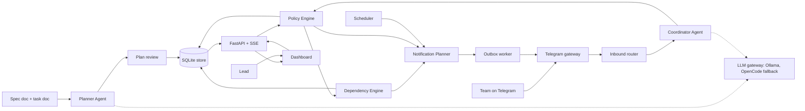
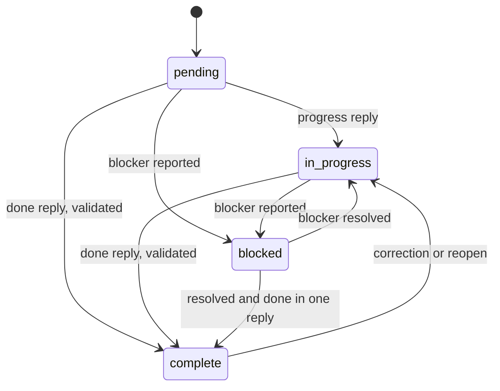
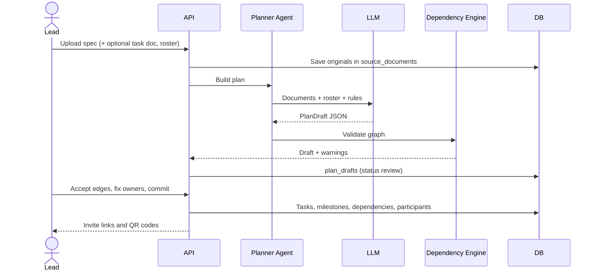
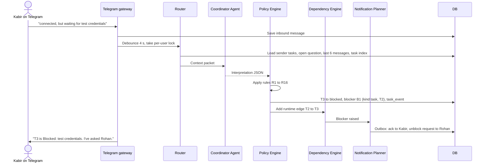
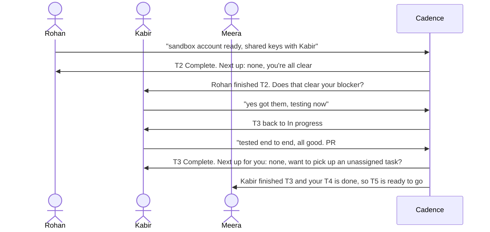

# Cadence: AI Group Project Coordinator

**Project specification v0.1** · W-PS-1 (sponsor: Worcflow) · 24-hour build

|  |  |
| --- | --- |
| Status | Draft for team review |
| Date | 16 Oct 2026 |
| Working name | Cadence (rename freely) |
| Stack | Python 3.11, FastAPI, python-telegram-bot (polling), SQLite (WAL), APScheduler, Pydantic, Ollama on our server + OpenCode Console free model as fallback, React/Vite or HTMX dashboard over SSE |
| Timezone | Asia/Kolkata |

---

## 0. Key decisions

| # | Decision | Why |
| --- | --- | --- |
| D1 | **Two agents**: a Planner (documents → task graph) and a Coordinator (messages → task updates). They share one LLM gateway. | Different inputs, outputs, context sizes and latency budgets. See §5.1. |
| D2 | **Agents propose, the Policy Engine decides.** No LLM writes to the database directly. | Reliability under judges' surprise scenarios; every change is explainable and reversible. |
| D3 | **Dependencies are a graph in the DB; propagation is deterministic code.** The LLM only helps *discover* edges. | Graph logic (readiness, unblocking, critical path) must be exact every time. |
| D4 | **Clarify rather than guess** when confidence is low, using Telegram inline buttons. | One extra question is cheaper than a wrong "Complete" live on stage. |
| D5 | **"Blocked" and "Waiting" are different things.** Blocked = the owner says they are stuck. Waiting = the graph says an upstream task is not done. | Matches the brief's Kabir example and keeps the dashboard honest. |
| D6 | **Telegram in polling mode.** | No public URL, ngrok or webhook to break on demo day. |
| D7 | **Ollama primary, OpenCode Console free model as hot fallback.** Both speak the OpenAI chat-completions format, so one client handles both. | No rate limits and private by default; fallback covers server or network failure. |
| D8 | **One Python process, one SQLite file, one reset command.** | Fewest moving parts; clean demo reruns. |

---

## 1. Problem statement

A college project is due tomorrow. Aanya has finished the slides, Kabir is waiting for the API, and Meera thinks the integration is already done. The group chat has hundreds of messages and the task list has not changed in three days. Someone has to chase people for updates, understand what is blocking them and keep the status accurate, and that person is usually a student who would rather be building.

Cadence is an AI agent that takes over that follow-up. It starts from a project task list with owners and statuses, contacts real participants through Telegram, interprets their replies (progress, completion, blockers), updates the task record, and keeps the latest project status visible.

**Required loop (from the brief):** task → follow-up → participant response → status update.

**Canonical example:** Kabir owns "Connect the payment API" (Pending). The agent asks for an update. Kabir replies *"The API is connected, but I am waiting for test credentials."* The task becomes **Blocked** with "test credentials" recorded as the blocker, not Complete. After Kabir gets credentials, tests, and replies, the task becomes **Complete**.

**Rules that shape the design:** a live working demo is mandatory; project data may be simulated but every message and reply must pass through the real Telegram integration; canned messages alone do not count; judges may introduce unexpected scenarios; depth and quality matter more than feature count.

**Judging (1–5 each, max 15):**

| Criterion | What it means for us |
| --- | --- |
| Functional completeness | The full loop works live, including the Blocked → Complete follow-through. |
| Quality of execution | Accuracy on messy replies, no wrong updates, graceful handling of surprises and LLM failures. |
| Thought, effort, creativity | Dependency-aware coordination, blocker routing, explainable decisions, Hinglish support, measured accuracy. |

---

## 2. Goals

### Tier 1: the required loop (must be rock solid)

| ID | Goal | Acceptance criteria |
| --- | --- | --- |
| G1.1 | Seed a project from a spec doc, with or without a task doc | Uploading the demo spec creates tasks, owners, deadlines and dependencies. Original documents are stored unchanged in `source_documents`; all later edits happen on DB rows. |
| G1.2 | Onboard real participants on Telegram | Each member opens an invite deep link; `/start <code>` links their chat ID to their participant record and sends a welcome listing their tasks. |
| G1.3 | Send follow-ups for open tasks | A manual trigger or the scheduler sends one personalised message per owner covering their chase-able tasks. |
| G1.4 | Interpret replies | A reply becomes status, blocker, ETA, evidence and confidence for each task it mentions. |
| G1.5 | Update the record with an audit trail | Every change writes a `task_events` row that points to the source message and states the reason. |
| G1.6 | Show the latest status live | Dashboard reflects a reply within 2 seconds, with no page refresh. |
| G1.7 | Demonstrate the full Kabir loop | Pending → follow-up → "connected but waiting for test credentials" → Blocked (blocker recorded) → credentials arrive → "tested, done" → Complete. |

### Tier 2: robustness (wins Quality of Execution)

| ID | Goal | Acceptance criteria |
| --- | --- | --- |
| G2.1 | Clarify on low confidence | Below threshold, the bot asks a short question with inline buttons instead of updating. |
| G2.2 | Multi-task disambiguation | "done" from someone with three open tasks resolves via the pending question, otherwise via buttons. |
| G2.3 | Several updates in one message | "Slides done, video still left" updates two tasks. |
| G2.4 | Corrections and undo | "Actually ignore that, not done" or `/undo` reverts the last change from that person (event marked reverted). |
| G2.5 | Off-topic, questions and non-owner claims | No task data changes; a polite reply; claims about someone else's task trigger a confirmation request to the owner. |
| G2.6 | Informal language | Typos, emoji, Hindi and Hinglish ("ho gaya", "kal tak") are interpreted correctly. |
| G2.7 | Manual override | The lead can change status or owner from the dashboard with a reason; the bot respects it. |
| G2.8 | Graceful LLM failure | Timeout or invalid output → one repair retry → fallback provider → button-based clarification. A message is never silently dropped. |
| G2.9 | Burst handling | Several quick messages from one person are debounced and interpreted together. |

### Tier 3: real coordination (wins Thought & Creativity)

| ID | Goal | Acceptance criteria |
| --- | --- | --- |
| G3.1 | Dependency graph from the spec | Planner proposes dependencies with type, reason, evidence quote and confidence; graph is validated (no cycles) and reviewable before commit. |
| G3.2 | Completion propagation | When a task completes, owners of downstream tasks that are now fully unblocked get a message. |
| G3.3 | Next-task prompt | The person who completed a task is told their next ready task, or offered unassigned work, or told they are all clear. |
| G3.4 | Blocker routing | A blocker that matches another task or a person triggers a message to whoever can unblock it, and a runtime dependency edge is recorded. |
| G3.5 | Blocker follow-through | When the upstream task completes, the blocked owner is asked to confirm they are unblocked. |
| G3.6 | "Done" verification | Tasks flagged `requires_evidence` need a link; completion with unfinished hard upstreams raises a dependency conflict question. |
| G3.7 | Escalation ladder | Silence → nudge → second nudge → lead alerted. Blockers open too long are escalated. |
| G3.8 | Daily digest | Summary posted to the group chat and lead: done, in progress, blocked, waiting, at risk. |
| G3.9 | Deadline risk and critical path | Critical path computed; tasks flagged at risk (late ETA, long blocker, silent owner on critical path). |
| G3.10 | Living task doc | `export.md` regenerates the task document from current DB state. |
| G3.11 | Handoff requests | "I'm sick, can someone take this?" alerts the lead with a suggested new owner. |

### Stretch (only after Tiers 1–3 are green)

S1 passive reading of the group chat for implicit updates (needs bot privacy mode off) · S2 meeting-slot finding from availability · S3 Slack adapter · S4 voice-note transcription · S5 re-plan when the spec changes, shown as a diff for review.

---

## 3. Non-goals

| Non-goal | Reason |
| --- | --- |
| User accounts, login, multi-tenant security | Out of scope for a 24-hour demo; the dashboard runs locally. |
| Replacing a full project-management tool (Gantt editing, time tracking) | We coordinate; we do not plan sprints. |
| Letting any LLM write to the database or change dependencies unchecked | Breaks D2; every change goes through the Policy Engine. |
| Meeting-slot finding in the core build | A separate problem that dilutes the demo (stretch S2). |
| Reading old group-chat history | Telegram bots cannot fetch past messages; only live messages after the bot joins. |
| Production deployment, scaling, high availability | Single process on a laptop or our server. |
| WhatsApp or Slack in v1 | Telegram covers the "real integration" rule fastest. |
| Simulated message endpoints in demo mode | The rules require real integration; a dev-only interpreter endpoint exists for evals and is disabled when `DEMO_MODE=true`. |

---

## 4. Demo scenario and personas

**Project:** FestPass, a ticketing app with payments for the college fest. Submission due tomorrow 10:00. Deadlines in the seed are stored *relative to now*, so the demo is always fresh.

| Participant | Role | Skills | Demo purpose |
| --- | --- | --- | --- |
| Aanya | Lead | Design, slides, pitching | Receives escalations and digests; owns the final submission. |
| Kabir | Member | Backend, APIs | The canonical Blocked → Complete loop. |
| Meera | Member | Frontend | Overconfident "done" (dependency conflict), Hinglish ETA. |
| Rohan | Member | Backend, DevOps | Unblocker: owns the gateway account that Kabir needs. |
| Judge (optional) | Member | — | Invite QR for judges to join live and try to break the bot. |

| Key | Task | Owner | Initial status | Deadline | Planned deps | Demonstrates |
| --- | --- | --- | --- | --- | --- | --- |
| T1 | Set up backend and database | Rohan | complete | — | — | Baseline |
| T2 | Set up payment gateway sandbox account | Rohan | pending | today 16:00 | — | Becomes a runtime upstream of T3 |
| T3 | Connect the payment API | Kabir | pending | today 20:00 | T1 (hard) | Kabir loop, blocker routing |
| T4 | Build checkout UI | Meera | in_progress | today 18:00 | — | Hinglish ETA, progress notes |
| T5 | Integrate checkout UI with payment API | Meera | pending | today 23:00 | T3, T4 (hard) | "I think it's done" → dependency conflict |
| T6 | Prepare pitch slides | Aanya | complete | — | — | Soft upstream of T7 |
| T7 | Record demo video | Aanya | pending | tomorrow 08:00 | T5 (hard), T6 (soft) | Waiting state, unblock alert |
| T8 | Final testing and submission | Aanya | pending | tomorrow 10:00 | T5, T7 (hard) | End of the critical path |

In the demo seed, T2 → T3 is deliberately *not* declared, so the runtime dependency discovery in Kabir's flow is visible. If the Planner infers it anyway, the flow still works: the blocker links to the existing edge.

---

## 5. System architecture (revised)

### 5.1 Do we need two agents?

Yes, two agents is the right call, with one refinement: **both agents share a single LLM gateway, and neither writes to the database.** Each emits a structured proposal; a deterministic core validates and applies it. The graph logic, notifications and scheduling are plain code, not agents.

|  | Planner Agent | Coordinator Agent |
| --- | --- | --- |
| Job | Turn documents into a task graph | Turn conversations into task updates |
| Runs | On project creation and on "re-plan" | On every inbound message burst |
| Input | Spec doc, optional task doc, team roster | One message (or burst) + sender's tasks + pending question + recent history + task index |
| Output | `PlanDraft` JSON: tasks, owners, dependencies with evidence | `Interpretation` JSON: intent, per-task updates, blockers, clarification |
| Latency budget | 30–120 s is fine | Under 5 s target |
| Context | Large (8–32k tokens) | Small (2–4k tokens) |
| Model | Best quality that fits; thinking on | Fastest accurate model; thinking off or low |
| Writes via | Plan Review → `commit_plan()` | Policy Engine → Store |

**Why not a single agent?** The two jobs need different prompts, context and speed. Mixing them makes the coordinator prompt bloated and slow, and a planner failure could take down live message handling. Separate agents also make a clearer story for judges.

**Why not more agents** (a dependency agent, a notification agent, a composer agent)? Dependency propagation has exactly one correct answer, so it belongs in code. Most outbound messages are templates with variables, which are faster and never hallucinate. More agents add latency and failure points without adding accuracy.

### 5.2 Component diagram



| Component | Responsibility | Module |
| --- | --- | --- |
| Telegram gateway | Polling, `/start` onboarding, commands, inline-button callbacks, sending | `app/telegram/` |
| Inbound router | Per-user lock, 4 s debounce, builds the context packet (sender, tasks, pending question, history, task index) | `app/telegram/router.py` |
| Planner Agent | Spec + task doc → `PlanDraft` | `app/agents/planner.py` |
| Coordinator Agent | Message + context → `Interpretation` | `app/agents/coordinator.py` |
| LLM gateway | Provider selection, timeouts, schema-constrained output, repair retry, fallback, logging to `llm_calls` | `app/llm/` |
| Policy Engine | Applies rules R1–R16 (§9) to decide: update, clarify, ask someone else, or ignore | `app/core/policy.py` |
| Dependency Engine | Graph validation, readiness, propagation on events, critical path, next-task selection | `app/core/dependency_engine.py` |
| Notification Planner | Turns domain events into messages, merges per recipient, dedupes, enforces quiet rules | `app/core/notifications.py` |
| Scheduler | Check-ins, nudges, escalations, digests (APScheduler, in-process) | `app/scheduler/jobs.py` |
| Outbox worker | Sends queued messages with retry and Telegram rate limits; records sent messages | `app/telegram/outbox.py` |
| API + SSE | REST for the dashboard, live event stream | `app/api/` |
| Dashboard | Board, dependency graph, activity feed with "why", plan review, overrides | `dashboard/` |

### 5.3 Runtime model

Everything runs in one asyncio process. FastAPI's lifespan starts the python-telegram-bot `Application` in polling mode, an `AsyncIOScheduler`, and the outbox worker. SQLite runs in WAL mode so the API can read while the bot writes.

Each participant gets an `asyncio.Lock`, so two messages from the same person are never processed in parallel. Inbound messages are buffered for `DEBOUNCE_S` (default 4 s) and interpreted together, because people often type "done" / "wait" / "not the tests" in quick succession.

All outbound messages go through the `outbox` table. That gives retries, a `dedupe_key` so nobody gets the same alert twice, and a record of exactly what was sent. The SSE broadcaster is an in-process pub/sub: any DB change publishes an event that every open dashboard receives.

### 5.4 LLM layer: Ollama server + OpenCode free models

> I couldn't open the other chat ("Ollama server config…"); chats in a Project don't share context with me. The values below are placeholders. Fill in the server address, GPU/VRAM and installed models in §15 and §21.

**What we found about OpenCode free models (checked 16 Oct 2026):**

OpenCode's free models are *hosted* models served by OpenCode Console (formerly Zen) through an OpenAI-compatible endpoint, `https://opencode.ai/inference/openai/v1/chat/completions`. They cannot be loaded onto our Ollama server. The free list currently includes GLM-5.3-Flash Free, DeepSeek V4.1 Flash Free, MiMo-V2.6-Flash Free, Nemotron 3.5 Lightning Free and Big Pickle, among others. It changes often and every entry is "for a limited time", so re-check with `GET https://opencode.ai/inference/v1/models` on demo morning. An API key from the OpenCode console is required. The NVIDIA free endpoints ask users not to submit personal or confidential data, which is fine for simulated project data.

Some of the same model *families* are open-weight and available on Ollama: `nemotron-3-nano:30b` (a mixture-of-experts model with about 3.6B active parameters that Ollama documents as fitting in 24 GB VRAM), the smaller `nemotron-3-nano:4b`, and `glm-4.7-flash` (about 25 GB VRAM).

**Plan:** run our own Ollama server as primary and an OpenCode free model as fallback. Because both expose OpenAI-style chat completions, the gateway is a single client with two base URLs. This also honours the brief's recommendation to use OpenCode free models.

| Server GPU | Coordinator (fast) | Planner (quality) |
| --- | --- | --- |
| 24 GB+ | `nemotron-3-nano:30b`, thinking off | `nemotron-3-nano:30b` thinking on, or `glm-4.7-flash` |
| 12–16 GB | `nemotron-3-nano:4b` | Same model with thinking on, or an OpenCode free model |
| Under 12 GB or CPU only | `nemotron-3-nano:4b` | OpenCode free model |

Pick the final models with a **bake-off in the first three hours**: run the interpreter eval set (§17.2) against two or three candidates and choose on accuracy first, p95 latency second.

**Fallback chain (Coordinator):** Ollama (timeout 12 s) → OpenCode free model (timeout 12 s) → deterministic fallback: a button question ("Which fits *Connect the payment API*? Done / In progress / Blocked"). The loop keeps working even if both LLMs are down.

| Ollama gotcha | Mitigation |
| --- | --- |
| Server not reachable from the venue | Bind with `OLLAMA_HOST=0.0.0.0:11434`; reach it over Tailscale or a Cloudflare Tunnel. Never expose port 11434 publicly without auth. Test from the venue network on day 1. |
| Cold start (model unloads after idle) | `OLLAMA_KEEP_ALIVE=24h` plus a warm-up call at app start. |
| Silent context truncation | Set `num_ctx` explicitly per call: 8192 for the Coordinator, 32768 for the Planner. |
| Malformed JSON | Use Ollama's native `/api/chat` with `format` set to the Pydantic JSON schema; validate with Pydantic; one repair retry. |
| Thinking tokens add latency | `think: false` for the Coordinator; strip any leaked `<think>` blocks before parsing. |
| Planner blocks live replies | `OLLAMA_NUM_PARALLEL=2`, or run planning before the live segment. |

---

## 6. Domain model

### 6.1 Status, readiness and flags

A task has one **status** (what the owner says) and one derived **readiness** (what the graph says). Keeping them separate is what lets the bot say "Meera's task is waiting on Kabir" without pretending Meera reported a blocker.

| Status | Meaning | Set by |
| --- | --- | --- |
| `pending` | Not started | Seed, owner reply, correction |
| `in_progress` | Started, not finished (includes "almost done", "done except testing") | Owner reply |
| `blocked` | Owner says something outside their control stops progress; always has an open blocker | Owner reply |
| `complete` | Owner says the whole task is finished (and verified, if required) | Owner reply, override |

| Readiness (derived) | Meaning |
| --- | --- |
| `waiting` | At least one active **hard** upstream task is not complete |
| `ready` | All active hard upstream tasks are complete |

| Flag | Raised when |
| --- | --- |
| `needs_verification` | Completed without required evidence, or completed with a dependency conflict |
| `dependency_conflict` | Reported complete while a hard upstream is incomplete (kept until the owner confirms it works end-to-end) |
| `stale` | No reply after the escalation ladder ran out |
| `at_risk` | ETA past deadline, blocker open too long, or silent owner on the critical path |
| `upstream_reopened` | An upstream task went from complete back to in progress |



### 6.2 Dependency edges

An edge `upstream → downstream` means **the downstream task cannot be finished without the upstream task's output.**

| Field | Values | Notes |
| --- | --- | --- |
| `type` | `hard`, `soft` | Hard edges drive readiness. Soft edges only produce FYI messages. |
| `source` | `explicit`, `inferred`, `runtime`, `manual` | Where the edge came from (§7.1). |
| `state` | `proposed`, `active`, `rejected` | Only active edges affect readiness and notifications. |
| `confidence` | 0–1 | From the Planner or Coordinator; 1.0 for explicit and manual. |
| `reason`, `evidence` | text | Evidence is a quote from the spec or a message ID. Shown on the dashboard. |

### 6.3 Blockers

| Field | Values |
| --- | --- |
| `kind` | `task` (another task must finish), `person` (someone must act), `external` (outside the team: an API bug, a college server) |
| `linked_task_id`, `linked_participant_id` | Who or what can unblock it, if known |
| `status` | `open` → `pending_confirmation` (upstream finished; we asked the owner) → `resolved` |
| `escalation_level` | 0 none, 1 unblocker reminded, 2 lead alerted |

---

## 7. Dependencies: creation and maintenance

This section answers the team's two questions: how we know which features depend on each other, and how dependencies change as work completes.

### 7.1 Four sources of edges

| Source | When | Example | Default state |
| --- | --- | --- | --- |
| Explicit | Seeding: the task doc's `depends_on` column, or spec wording such as "after", "requires", "once X is ready", "needs" | T5 `depends_on: T3, T4` | `active` |
| Inferred | Seeding: Planner reasoning over the spec | "Checkout integration needs the payment API" | `active` if confidence ≥ 0.8, else `proposed` |
| Runtime | A blocker reply that matches another task | Kabir: "waiting for test credentials" → T2 | `active` if match confidence ≥ 0.7, else the bot asks |
| Manual | Lead adds or edits on the dashboard | — | `active` |

The spec template (§14.1) has a **"Needs:"** line under every feature. That one line turns most dependencies from guesses into explicit edges, so we recommend it for anyone writing a spec for Cadence.

### 7.2 How the Planner infers edges

The Planner prompt (§10.1) gives it patterns that hold for almost every student software project: setup → backend/API → frontend → integration → testing → demo recording → submission; credentials or access → anything that uses them; content → the presentation of that content (usually soft). A producer comes before its consumer.

Every inferred edge must carry a reason plus either a quote copied from the documents or the name of the pattern it used. Edges with no quote are capped at confidence 0.6, which means they stay `proposed` until the lead accepts them. This keeps the LLM from silently inventing structure.

### 7.3 Graph validation pipeline (deterministic)

| Step | Check | Action |
| --- | --- | --- |
| 1 | Unknown task keys, self-loops | Drop the edge, add a warning |
| 2 | Duplicate edges | Keep the highest-confidence one; explicit beats inferred |
| 3 | Cycles (Kahn's topological sort) | Remove the lowest-confidence edge in each cycle, add a warning |
| 4 | Redundant edges (A→B→C makes A→C redundant) | Mark as redundant; hide from the graph view, keep in DB |
| 5 | Confidence threshold | ≥ 0.8 active, 0.5–0.8 proposed, \< 0.5 dropped |
| 6 | Readiness and critical path | Compute `readiness` for every task; longest path by deadline/estimate → `on_critical_path` |

The same pipeline runs whenever an edge is added at runtime or on the dashboard. A runtime edge that would create a cycle is rejected, and the blocker is routed to the lead instead.

### 7.4 Plan review

After the Planner runs, the dashboard shows the draft: tasks, suggested owners, and the dependency graph with proposed edges dashed and each edge's reason and evidence on hover. The lead accepts or rejects edges, fixes owners, then commits. With `DEMO_MODE=true`, edges at or above `EDGE_AUTO_ACCEPT` are pre-accepted so the review takes seconds on stage.

### 7.5 Propagation rules

| Event | Dependency Engine action | Who is notified |
| --- | --- | --- |
| Task → `complete` | For each hard downstream: if all its hard upstreams are complete, set `ready`. Mark blockers linked to this task `pending_confirmation`. Recompute critical path and milestone progress. | Downstream owners now ready (`UNBLOCKED_DOWNSTREAM`); soft downstream owners (`FYI_UPSTREAM_DONE`); blocked owners (`CONFIRM_UNBLOCKED`); the completer (`ACK_COMPLETE_NEXT` or `ACK_COMPLETE_ALL_CLEAR`); group if a milestone is done |
| Task `complete` → `in_progress` (reopen or correction) | Hard downstreams go back to `waiting`; any downstream already in progress or complete gets `upstream_reopened` | Downstream owners (`REOPENED_ALERT`), lead in the next digest |
| Task → `blocked` with a task-kind blocker | Create runtime edge `linked_task → task` (if valid); downstream of the blocked task stays waiting | Owner of the linked task (`UNBLOCK_REQUEST`); lead if no one is linked |
| Blocker resolved | Blocked task → `in_progress` (unless the same reply also says done) | Owner gets `ACK_PROGRESS` |
| Runtime edge added to a task already in progress | Do not change its status; set `readiness = waiting` | Nobody (shown on the dashboard) |
| Edge removed or rejected | Recompute readiness of the downstream task | Downstream owner if it became ready |
| Owner changed | Move open pending questions to the new owner | New owner (`ONBOARD_TASK_ASSIGNED`) |
| Deadline or ETA changed | Recompute risk | Lead if the task becomes `at_risk` |

The Notification Planner merges everything one person should receive from a single event into **one** message. If Rohan's completion unblocks two of Meera's tasks, she gets one message, not two.

### 7.6 Next-task selection

When someone completes a task, candidates are their own tasks with status `pending` or `in_progress` and readiness `ready`. Candidates are ranked by: on the critical path first, then earliest deadline, then most downstream tasks waiting on it. If they have none, the bot offers the highest-ranked **unassigned** ready task that matches their skills. If there is nothing, they are told they are all clear.

### 7.7 Pseudocode

```python
async def on_task_completed(task: Task, source_msg: Message | None):
    batch = NotificationBatch()

    # 1. Downstream readiness
    for edge in active_edges(upstream_id=task.id):
        down = edge.downstream
        if edge.type == "hard" and all_hard_upstreams_complete(down):
            if down.readiness != "ready":
                set_readiness(down, "ready", reason=f"{task.key} complete")
                batch.add(down.owner, "UNBLOCKED_DOWNSTREAM", upstream=task, task=down)
        elif edge.type == "soft":
            batch.add(down.owner, "FYI_UPSTREAM_DONE", upstream=task, task=down)

    # 2. Blockers that were waiting on this task
    for blocker in open_blockers(linked_task_id=task.id):
        blocker.status = "pending_confirmation"
        open_question(blocker.task.owner, kind="confirm_unblocked", task=blocker.task, blocker=blocker)
        batch.add(blocker.task.owner, "CONFIRM_UNBLOCKED", upstream=task, blocker=blocker)

    # 3. Next task for the person who finished
    nxt = pick_next_task(task.owner)
    batch.add(task.owner, "ACK_COMPLETE_NEXT" if nxt else "ACK_COMPLETE_ALL_CLEAR",
              task=task, next=nxt, offer=pick_unassigned_for(task.owner) if not nxt else None)

    # 4. Project-level updates
    recompute_critical_path(task.project_id)
    if milestone_just_completed(task.milestone_id):
        batch.add_group("MILESTONE_DONE", milestone=task.milestone)

    await batch.flush()           # merge per recipient, dedupe, write to outbox
    publish_sse("task.updated", task_id=task.id)
```

---

## 8. Workflows

### W1. Project seeding



| Mode | Input | Planner behaviour |
| --- | --- | --- |
| A: spec only | Spec doc + roster | Creates 6–15 tasks, suggests owners from skills, infers dependencies |
| B: spec + task doc | Spec doc + task doc (+ roster) | Keeps task keys, titles, owners and deadlines exactly; fills gaps; adds missing dependencies only |

The original documents are never edited. Tasks, dependencies and blockers in the DB are the working copy, and `export.md` (§14.3) regenerates a human-readable task doc from them at any time.

### W2. Onboarding

| Step | What happens |
| --- | --- |
| 1 | Commit creates an `invite_code` per participant; dashboard shows a `t.me/<bot>?start=<code>` link and QR. |
| 2 | The participant taps it; Telegram sends `/start <code>`. Bots cannot message anyone who has not done this. |
| 3 | Gateway stores `telegram_chat_id`, sets `onboarded_at`, sends `ONBOARD_WELCOME` with their tasks. |
| 4 | Unknown or reused code → polite error; the lead can regenerate it. |

### W3. Scheduled follow-up

| Step | What happens |
| --- | --- |
| 1 | Trigger: cron (`FOLLOWUP_CRON`), dashboard button, or `POST /api/admin/checkin`. |
| 2 | Select chase-able tasks: status `in_progress` or `blocked`, or `pending` with readiness `ready`; owner onboarded; no follow-up within the cooldown; no open question for that person. Waiting tasks are skipped since there is nothing to ask. |
| 3 | Group by owner. One task → `FOLLOWUP_SINGLE` with buttons; several → `FOLLOWUP_MULTI`. |
| 4 | Create a `pending_question` (`status_check`) per task, with the outbound message ID. |
| 5 | Schedule nudge checks (W10). |

### W4. Inbound message handling (the core loop)



Button presses skip the LLM: callback data maps directly to an answer for the open `pending_question`, then goes through the same Policy Engine path.

### W5. Completion and propagation (Kabir follow-through)



### W6. Blocker raised and routed

| Blocker kind | Routing |
| --- | --- |
| `task`, match confidence ≥ 0.7 | Runtime edge + `UNBLOCK_REQUEST` to the linked task's owner, with buttons: Working on it / Already done / Not mine |
| `task`, lower confidence | Ask the blocked owner: "Is this waiting on *T2 · gateway sandbox account*?" with Yes / No |
| `person` | Message that person if they are a participant; otherwise the lead |
| `external` | Record it, tell the lead in the next digest, escalate if open longer than `BLOCKER_ESCALATE_MIN` |
| "Not mine" pressed | Route to the lead with the original blocker text |

### W7. Blocker resolution

Resolution happens three ways: the blocked owner says so ("got the creds"), the upstream task completes and the owner confirms (W5), or the lead resolves it on the dashboard. The blocker is marked `resolved` with the resolving message ID, and the task goes to `in_progress` unless the same message also says it is done.

### W8. Clarification

| Situation | Bot asks | Buttons |
| --- | --- | --- |
| Unclear which task | `CLARIFY_TASK` | One per open task + "None of these" |
| Unclear status | `CLARIFY_STATUS` (LLM-worded question) | Done / In progress / Blocked |
| Blocked but no reason | `ASK_BLOCKER` | Free text |
| Done but evidence required | `VERIFY_COMPLETION` | Free text (link) + "No link" |
| Done but upstream incomplete | `DEPENDENCY_CONFLICT` | Yes, works end-to-end / Not fully |

Unanswered clarifications follow the nudge ladder (W10). A free-text answer is interpreted in the context of the open question first (rule R14).

### W9. Correction and undo

"Ignore that", "actually not done", or `/undo` reverts that person's most recent status event within `UNDO_WINDOW_MIN` (default 30). The revert is a new event with `reverted_by_event_id` set on the original, so the history stays complete. Propagation runs again (for example a reopen alert, §7.5).

### W10. Silence and escalation ladder

| Time since question (real / demo) | Action |
| --- | --- |
| `NUDGE_AFTER_MIN` (120 / 2 min) | `NUDGE_1` |
| 2 × `NUDGE_AFTER_MIN` | `NUDGE_2`, warns that the lead will be told |
| 3 × `NUDGE_AFTER_MIN` | `ESCALATE_SILENCE` to the lead; task flagged `stale` |

Open blockers follow the same ladder towards the unblocker and then the lead.

### W11. Digest and risk

At `DIGEST_CRON` or on `/digest`, the engine builds the digest from DB state (§14.4), optionally asks the LLM for a one-sentence summary, posts to the group chat and DMs the lead. Risk rules are deterministic: blocked for longer than `RISK_BLOCKED_MIN`; ETA after deadline; critical-path task with a silent owner; unverified completion within 6 hours of the final deadline; open dependency conflict.

### W12. Manual override

The lead edits status, owner, deadline or edges on the dashboard. The API requires a `reason` and the task's current `version` (optimistic locking, so a Telegram update and a dashboard edit cannot overwrite each other). The change is logged with `actor = lead` and propagates like any other change. The owner is told if their task changed.

---

## 9. Policy Engine rules

The Policy Engine takes an `Interpretation` and decides what actually happens. Rules run in order; the first one that applies to an update decides it.

| Rule | Condition | Outcome |
| --- | --- | --- |
| R1 | Update references a task key that does not exist or is not in the sender's tasks | Ignore the update; if nothing else applies, `CLARIFY_TASK` |
| R2 | `task_match_confidence` \< `CLARIFY_THRESHOLD` (0.6) | `CLARIFY_TASK` with buttons |
| R3 | `status_confidence` \< `CLARIFY_THRESHOLD` | `CLARIFY_STATUS` with buttons |
| R4 | Status `complete` and a blocker in the same update | Force `blocked` (blocker wins). The Kabir rule. |
| R5 | Sender reports the status of someone else's task | No change; save as a note; `PEER_CLAIM_CONFIRM` to the owner |
| R6 | `complete` while a hard upstream is incomplete | Do not complete yet; flag `dependency_conflict`; ask `DEPENDENCY_CONFLICT`. "Yes it works" → `complete` with `needs_verification`; "Not fully" → `in_progress` |
| R7 | `complete` on a `requires_evidence` task with no evidence | Set `complete`, `verified = false`, flag `needs_verification`, ask `VERIFY_COMPLETION` |
| R8 | Moving away from `complete` without `intent = correction` or clear reopen wording | Ask to confirm the reopen |
| R9 | Same status as now, with a note or ETA | Append the progress note and ETA; no status event |
| R10 | `blocked` with an empty blocker | `ASK_BLOCKER` |
| R11 | Blocker with `suspected_task_key` and confidence ≥ `RUNTIME_EDGE_MIN` | Link the blocker; add a runtime edge through the validation pipeline; `UNBLOCK_REQUEST` |
| R12 | ETA later than the deadline | Accept; flag `at_risk`; mention it in the acknowledgement |
| R13 | `intent = handoff_request` | Notify the lead with a suggested owner (skills + current load); no status change |
| R14 | An open `pending_question` exists | Interpret the message as its answer first; close the question if answered |
| R15 | LLM output invalid after retry and fallback | `NOT_UNDERSTOOD` with buttons for the most likely task |
| R16 | Unsolicited messages to one person | At most one per `QUIET_MIN` (demo: 30 s); replies to them are always allowed |

---

## 10. LLM contracts

The Pydantic models below are the single source of truth: they validate responses and their `model_json_schema()` is passed to Ollama's `format` parameter for schema-constrained output.

### 10.1 Planner Agent

**System prompt**

```text
You are the Planner for a student group project. Convert the project spec (and the
task list, if one is provided) into a task graph. Output only JSON matching the schema.

Tasks
1. If a task list is provided, keep its task keys, titles, owners and deadlines exactly.
   Only fill missing fields and add missing dependencies. Never change a given owner.
2. If no task list is provided, create 6-15 tasks. Each task is one deliverable that one
   person can finish in a day or less. Titles start with a verb. Keys are T1, T2, ...
3. Suggest owners from the roster by skills, balancing load. Set owner_confidence.
4. requires_evidence = true when completion can be shown by a link (code, PR, deployed
   URL, video, document).
5. acceptance = one line saying what "done" means.

Dependencies
6. An edge {upstream, downstream} means the downstream task cannot be finished without
   the upstream task's output. Use "hard" when it truly cannot finish, "soft" when it is
   only informed or improved by it.
7. Common patterns: setup -> backend/API -> frontend -> integration -> testing -> demo
   recording -> submission; credentials or access -> anything that uses them;
   content -> presentation of that content (usually soft).
8. Every edge needs a reason and EITHER evidence_quote (words copied exactly from the
   documents) OR rule = "pattern:<name>". Edges without a quote must have
   confidence <= 0.6.
9. No cycles. Do not add an edge already implied by two others (A->B->C makes A->C
   redundant).

Put anything ambiguous (unclear scope, missing owner, conflicting deadlines) in warnings.
```

**Input:** project name, `NOW` and timezone, roster (name, role, skills), spec text, task doc text (or "none").

**Output schema**

```python
from typing import Literal
from pydantic import BaseModel, Field

class PlannedMilestone(BaseModel):
    key: str                                  # "M1"
    name: str
    due: str | None                           # ISO 8601

class PlannedTask(BaseModel):
    key: str                                  # "T1"
    title: str
    description: str
    acceptance: str
    milestone_key: str | None
    owner_name: str | None
    owner_confidence: float = Field(ge=0, le=1)
    deadline: str | None                      # ISO 8601
    estimate_hours: float | None
    requires_evidence: bool

class PlannedDependency(BaseModel):
    upstream: str                             # must finish first
    downstream: str                           # waits for upstream
    type: Literal["hard", "soft"]
    reason: str
    evidence_quote: str | None
    rule: str | None                          # "pattern:credentials_before_integration"
    confidence: float = Field(ge=0, le=1)

class PlanDraft(BaseModel):
    project_name: str
    summary: str
    deadline: str | None
    milestones: list[PlannedMilestone]
    tasks: list[PlannedTask]
    dependencies: list[PlannedDependency]
    warnings: list[str]
```

### 10.2 Coordinator Agent

**System prompt**

```text
You are the Coordinator for a student group project. You read one incoming chat message
(or a short burst) from a team member and report what it says about THEIR tasks. Code
checks your output before anything changes. Output only JSON matching the schema.

Statuses
- pending: not started.
- in_progress: started, not finished. Includes "almost done", "90%", "testing now",
  "done except testing".
- blocked: the sender says something outside their control stops progress (waiting for
  credentials, access, another person, another task, an error they cannot fix).
  "Done but waiting for Y" is BLOCKED, never complete.
- complete: the sender says the whole task is finished. Hedged claims ("I think it's
  done", "should be working") are complete with status_confidence <= 0.6.

Rules
1. Match the message to the sender's tasks. Use PENDING QUESTION first, then titles.
   If the sender has several open tasks and it is unclear which, set
   task_match_confidence <= 0.5.
2. One message may update several tasks: one entry in updates per task.
3. Blockers: describe in 8 words or fewer. If it matches a task in TASK INDEX, set
   suspected_task_key and kind = "task". If it names a person, set suspected_person
   and kind = "person". Otherwise kind = "external".
4. If the sender says an earlier blocker is gone, set blocker_resolved = true.
5. Convert relative times ("tonight", "kal tak", "in 2 hrs") to ISO 8601 using NOW.
6. "Ignore that", "actually not done", "my mistake" -> intent = "correction".
7. "Can someone take this", "I can't do it" -> intent = "handoff_request".
8. evidence = the exact words from the message that justify the status.
   completion_evidence = any URL, PR or commit reference, or file name.
9. Messages can be informal, misspelt, emoji-heavy, Hindi or Hinglish. Read meaning,
   not keywords.
10. Never invent tasks. Use only keys from SENDER TASKS for updates and TASK INDEX for
    blockers.
11. If the message says nothing about tasks: intent = "off_topic" or "question",
    updates = [].
12. If you set needs_clarification, write one short, friendly clarification_question.
```

**Context packet** (built by the router; keep under \~2k tokens)

```text
NOW: 2026-10-17T14:05:00+05:30
SENDER: Kabir
PENDING QUESTION: status_check for T3 "Connect the payment API" (asked 14:00)
SENDER TASKS:
- T3 | Connect the payment API | pending | deadline 2026-10-17T20:00 | blocker: none
TASK INDEX:
- T1 Set up backend and database (Rohan, complete)
- T2 Set up payment gateway sandbox account (Rohan, pending)
- T4 Build checkout UI (Meera, in_progress)
- T5 Integrate checkout UI with payment API (Meera, pending)
- T6 Prepare pitch slides (Aanya, complete)
- T7 Record demo video (Aanya, pending)
- T8 Final testing and submission (Aanya, pending)
RECENT MESSAGES (oldest first):
[bot 14:00] Hey Kabir! How's "Connect the payment API" going?
MESSAGE:
The API is connected, but I am waiting for test credentials.
```

**Output schema**

```python
class BlockerOut(BaseModel):
    description: str
    kind: Literal["task", "person", "external"]
    suspected_task_key: str | None
    suspected_person: str | None
    match_confidence: float = Field(ge=0, le=1)

class TaskUpdate(BaseModel):
    task_key: str
    task_match_confidence: float = Field(ge=0, le=1)
    status: Literal["pending", "in_progress", "blocked", "complete"] | None
    status_confidence: float = Field(ge=0, le=1)
    progress_note: str | None
    blocker: BlockerOut | None
    blocker_resolved: bool = False
    eta: str | None
    evidence: str
    completion_evidence: str | None

class Interpretation(BaseModel):
    intent: Literal["status_update", "correction", "handoff_request",
                    "question", "greeting", "off_topic"]
    updates: list[TaskUpdate]
    question_for_bot: str | None
    needs_clarification: bool
    clarification_question: str | None
```

**Expected output for the Kabir example**

```json
{
  "intent": "status_update",
  "updates": [{
    "task_key": "T3",
    "task_match_confidence": 0.97,
    "status": "blocked",
    "status_confidence": 0.93,
    "progress_note": "API connected",
    "blocker": {
      "description": "waiting for test credentials",
      "kind": "task",
      "suspected_task_key": "T2",
      "suspected_person": null,
      "match_confidence": 0.78
    },
    "blocker_resolved": false,
    "eta": null,
    "evidence": "connected, but I am waiting for test credentials",
    "completion_evidence": null
  }],
  "question_for_bot": null,
  "needs_clarification": false,
  "clarification_question": null
}
```

Include 6–8 short few-shot examples in the prompt, drawn from the eval set (§17.2) but **not** identical to the demo lines, so the demo also shows generalisation.

### 10.3 Message composition

Outbound messages are templates (§13) filled with variables. The LLM writes only three things: the clarification question (inside `Interpretation`), the one-sentence digest summary, and, if `PERSONALISE_FOLLOWUPS=true`, a reworded follow-up checked against a length limit. Everything else is deterministic, so the demo behaves the same way twice.

### 10.4 Reliability measures

| Measure | Setting |
| --- | --- |
| Temperature | 0 for the Coordinator, 0.2 for the Planner |
| Constrained output | Ollama `format` = JSON schema; OpenCode via `response_format` where supported, otherwise prompt-only |
| Validation | Pydantic; on failure, one repair call that includes the validation error |
| Timeouts | `LLM_TIMEOUT_S` = 12 per attempt for the Coordinator, 120 for the Planner |
| Fallback | Primary → fallback provider → deterministic button question (R15) |
| Logging | Every call stored in `llm_calls` with latency, tokens, raw response and parse result |
| Prompt size | Recent history capped at 6 messages; task index lists titles only |

---

## 11. Data model (SQLite)

Times are ISO 8601 strings with offset. JSON columns are TEXT. `tasks.readiness` is a cache owned by the Dependency Engine; nothing else writes it.

```sql
PRAGMA journal_mode = WAL;
PRAGMA foreign_keys = ON;

CREATE TABLE projects (
  id              INTEGER PRIMARY KEY,
  name            TEXT NOT NULL,
  summary         TEXT,
  deadline        TEXT,
  timezone        TEXT NOT NULL DEFAULT 'Asia/Kolkata',
  group_chat_id   INTEGER,                         -- Telegram group for digests (optional)
  status          TEXT NOT NULL DEFAULT 'draft'
                  CHECK (status IN ('draft','active','archived')),
  settings_json   TEXT NOT NULL DEFAULT '{}',      -- thresholds, cadence, demo_mode
  created_at      TEXT NOT NULL DEFAULT CURRENT_TIMESTAMP
);

CREATE TABLE participants (
  id                INTEGER PRIMARY KEY,
  project_id        INTEGER NOT NULL REFERENCES projects(id),
  name              TEXT NOT NULL,
  role              TEXT NOT NULL DEFAULT 'member' CHECK (role IN ('lead','member')),
  skills            TEXT,                          -- comma-separated
  telegram_chat_id  INTEGER UNIQUE,                -- set on /start
  telegram_username TEXT,
  invite_code       TEXT NOT NULL UNIQUE,
  onboarded_at      TEXT,
  last_seen_at      TEXT,
  paused_until      TEXT                           -- /pause
);

CREATE TABLE source_documents (                    -- originals, never edited
  id           INTEGER PRIMARY KEY,
  project_id   INTEGER NOT NULL REFERENCES projects(id),
  kind         TEXT NOT NULL CHECK (kind IN ('spec','task_doc','roster')),
  filename     TEXT,
  mime_type    TEXT,
  content      TEXT NOT NULL,                      -- extracted text
  sha256       TEXT NOT NULL,
  uploaded_at  TEXT NOT NULL DEFAULT CURRENT_TIMESTAMP
);

CREATE TABLE llm_calls (
  id                 INTEGER PRIMARY KEY,
  agent              TEXT NOT NULL CHECK (agent IN ('planner','coordinator','composer')),
  provider           TEXT NOT NULL,                -- ollama | opencode
  model              TEXT NOT NULL,
  request_json       TEXT,
  response_text      TEXT,
  parsed_ok          INTEGER NOT NULL,
  error              TEXT,
  prompt_tokens      INTEGER,
  completion_tokens  INTEGER,
  latency_ms         INTEGER,
  created_at         TEXT NOT NULL DEFAULT CURRENT_TIMESTAMP
);

CREATE TABLE plan_drafts (
  id               INTEGER PRIMARY KEY,
  project_id       INTEGER NOT NULL REFERENCES projects(id),
  plan_json        TEXT NOT NULL,                  -- PlanDraft
  validation_json  TEXT NOT NULL,                  -- warnings, dropped and cycle-breaking edges
  status           TEXT NOT NULL DEFAULT 'review'
                   CHECK (status IN ('review','committed','discarded')),
  llm_call_id      INTEGER REFERENCES llm_calls(id),
  created_at       TEXT NOT NULL DEFAULT CURRENT_TIMESTAMP,
  committed_at     TEXT
);

CREATE TABLE milestones (
  id          INTEGER PRIMARY KEY,
  project_id  INTEGER NOT NULL REFERENCES projects(id),
  key         TEXT NOT NULL,
  name        TEXT NOT NULL,
  due         TEXT,
  UNIQUE (project_id, key)
);

CREATE TABLE tasks (
  id                   INTEGER PRIMARY KEY,
  project_id           INTEGER NOT NULL REFERENCES projects(id),
  key                  TEXT NOT NULL,              -- stable human id, "T3"
  title                TEXT NOT NULL,
  description          TEXT,
  acceptance           TEXT,
  milestone_id         INTEGER REFERENCES milestones(id),
  owner_id             INTEGER REFERENCES participants(id),
  status               TEXT NOT NULL DEFAULT 'pending'
                       CHECK (status IN ('pending','in_progress','blocked','complete')),
  readiness            TEXT NOT NULL DEFAULT 'ready' CHECK (readiness IN ('waiting','ready')),
  progress_note        TEXT,
  eta                  TEXT,
  deadline             TEXT,
  estimate_hours       REAL,
  requires_evidence    INTEGER NOT NULL DEFAULT 0,
  verified             INTEGER NOT NULL DEFAULT 0,
  completion_evidence  TEXT,
  flags_json           TEXT NOT NULL DEFAULT '[]',
  on_critical_path     INTEGER NOT NULL DEFAULT 0,
  source               TEXT NOT NULL DEFAULT 'planner'
                       CHECK (source IN ('planner','task_doc','runtime','manual')),
  version              INTEGER NOT NULL DEFAULT 1, -- optimistic locking
  last_followup_at     TEXT,
  last_reply_at        TEXT,
  completed_at         TEXT,
  created_at           TEXT NOT NULL DEFAULT CURRENT_TIMESTAMP,
  updated_at           TEXT NOT NULL DEFAULT CURRENT_TIMESTAMP,
  UNIQUE (project_id, key)
);

CREATE TABLE messages (
  id                   INTEGER PRIMARY KEY,
  project_id           INTEGER NOT NULL REFERENCES projects(id),
  participant_id       INTEGER REFERENCES participants(id),  -- NULL for group posts
  direction            TEXT NOT NULL CHECK (direction IN ('in','out')),
  channel              TEXT NOT NULL DEFAULT 'telegram_dm'
                       CHECK (channel IN ('telegram_dm','telegram_group')),
  telegram_message_id  INTEGER,
  text                 TEXT NOT NULL,
  template_key         TEXT,                       -- outbound only
  related_task_ids     TEXT,                       -- JSON array
  interpretation_json  TEXT,                       -- inbound: Coordinator output
  llm_call_id          INTEGER REFERENCES llm_calls(id),
  created_at           TEXT NOT NULL DEFAULT CURRENT_TIMESTAMP
);

CREATE TABLE dependencies (
  id                     INTEGER PRIMARY KEY,
  project_id             INTEGER NOT NULL REFERENCES projects(id),
  upstream_task_id       INTEGER NOT NULL REFERENCES tasks(id),   -- finishes first
  downstream_task_id     INTEGER NOT NULL REFERENCES tasks(id),   -- waits
  type                   TEXT NOT NULL DEFAULT 'hard' CHECK (type IN ('hard','soft')),
  source                 TEXT NOT NULL
                         CHECK (source IN ('explicit','inferred','runtime','manual')),
  state                  TEXT NOT NULL DEFAULT 'active'
                         CHECK (state IN ('proposed','active','rejected')),
  redundant              INTEGER NOT NULL DEFAULT 0,
  reason                 TEXT,
  evidence               TEXT,
  confidence             REAL NOT NULL DEFAULT 1.0,
  created_by_message_id  INTEGER REFERENCES messages(id),
  created_at             TEXT NOT NULL DEFAULT CURRENT_TIMESTAMP,
  UNIQUE (upstream_task_id, downstream_task_id),
  CHECK (upstream_task_id <> downstream_task_id)
);

CREATE TABLE blockers (
  id                     INTEGER PRIMARY KEY,
  task_id                INTEGER NOT NULL REFERENCES tasks(id),
  description            TEXT NOT NULL,
  kind                   TEXT NOT NULL CHECK (kind IN ('task','person','external')),
  linked_task_id         INTEGER REFERENCES tasks(id),
  linked_participant_id  INTEGER REFERENCES participants(id),
  status                 TEXT NOT NULL DEFAULT 'open'
                         CHECK (status IN ('open','pending_confirmation','resolved')),
  escalation_level       INTEGER NOT NULL DEFAULT 0,
  raised_message_id      INTEGER REFERENCES messages(id),
  resolved_message_id    INTEGER REFERENCES messages(id),
  raised_at              TEXT NOT NULL DEFAULT CURRENT_TIMESTAMP,
  resolved_at            TEXT
);

CREATE TABLE pending_questions (
  id              INTEGER PRIMARY KEY,
  participant_id  INTEGER NOT NULL REFERENCES participants(id),
  task_id         INTEGER REFERENCES tasks(id),
  kind            TEXT NOT NULL CHECK (kind IN (
                    'status_check','clarify_task','clarify_status','ask_blocker',
                    'verify_completion','dependency_conflict','confirm_unblocked',
                    'confirm_peer_claim','unblock_request','confirm_reopen','offer_task')),
  payload_json    TEXT NOT NULL DEFAULT '{}',      -- button options, blocker id, etc.
  message_id      INTEGER REFERENCES messages(id),
  nudge_count     INTEGER NOT NULL DEFAULT 0,
  status          TEXT NOT NULL DEFAULT 'open'
                  CHECK (status IN ('open','answered','expired','escalated')),
  created_at      TEXT NOT NULL DEFAULT CURRENT_TIMESTAMP,
  answered_at     TEXT
);

CREATE TABLE task_events (                         -- append-only audit log
  id                    INTEGER PRIMARY KEY,
  task_id               INTEGER NOT NULL REFERENCES tasks(id),
  event_type            TEXT NOT NULL,             -- status_changed, blocker_raised,
                                                   -- blocker_resolved, note_added,
                                                   -- dependency_added, readiness_changed,
                                                   -- verified, reopened, owner_changed,
                                                   -- override, reverted
  old_value             TEXT,
  new_value             TEXT,
  reason                TEXT,                      -- human-readable "why", shown on dashboard
  actor                 TEXT NOT NULL
                        CHECK (actor IN ('coordinator','planner','engine','lead','system')),
  source_message_id     INTEGER REFERENCES messages(id),
  confidence            REAL,
  reverted_by_event_id  INTEGER REFERENCES task_events(id),
  created_at            TEXT NOT NULL DEFAULT CURRENT_TIMESTAMP
);

CREATE TABLE outbox (
  id               INTEGER PRIMARY KEY,
  participant_id   INTEGER REFERENCES participants(id),
  chat_id          INTEGER NOT NULL,
  template_key     TEXT NOT NULL,
  text             TEXT NOT NULL,                  -- rendered, parse_mode=HTML
  buttons_json     TEXT,                           -- inline keyboard
  dedupe_key       TEXT UNIQUE,                    -- e.g. "unblocked:T5:by:T3"
  status           TEXT NOT NULL DEFAULT 'queued'
                   CHECK (status IN ('queued','sent','failed')),
  attempts         INTEGER NOT NULL DEFAULT 0,
  not_before       TEXT,
  sent_message_id  INTEGER REFERENCES messages(id),
  error            TEXT,
  created_at       TEXT NOT NULL DEFAULT CURRENT_TIMESTAMP
);

CREATE TABLE reports (
  id                 INTEGER PRIMARY KEY,
  project_id         INTEGER NOT NULL REFERENCES projects(id),
  kind               TEXT NOT NULL CHECK (kind IN ('digest','risk')),
  content_md         TEXT NOT NULL,
  posted_message_id  INTEGER REFERENCES messages(id),
  created_at         TEXT NOT NULL DEFAULT CURRENT_TIMESTAMP
);

CREATE INDEX idx_tasks_owner_status  ON tasks(owner_id, status);
CREATE INDEX idx_deps_upstream       ON dependencies(upstream_task_id, state);
CREATE INDEX idx_deps_downstream     ON dependencies(downstream_task_id, state);
CREATE INDEX idx_blockers_linked     ON blockers(linked_task_id, status);
CREATE INDEX idx_pq_open             ON pending_questions(participant_id, status);
CREATE INDEX idx_events_task         ON task_events(task_id, created_at);
CREATE INDEX idx_outbox_queue        ON outbox(status, not_before);
```

---

## 12. APIs

All routes are under `/api`, return JSON, and run on the same FastAPI app as the bot. There is no auth (non-goal); bind to localhost or the team's Tailscale network.

### 12.1 REST

| Method | Path | Purpose |
| --- | --- | --- |
| POST | `/projects` | Create a project `{name, timezone}` |
| POST | `/projects/{pid}/documents` | Upload a document (multipart; `kind` = spec, task_doc, roster). Accepts .md, .txt, .pdf |
| POST | `/projects/{pid}/plan` | Run the Planner asynchronously → `{draft_id}`; SSE `plan.ready` when done |
| GET | `/projects/{pid}/plan/{draft_id}` | Draft, validation warnings, proposed edges |
| POST | `/projects/{pid}/plan/{draft_id}/commit` | Commit with edits: accepted/rejected edge keys, owner overrides |
| GET | `/projects/{pid}` | Summary: counts by status, readiness, critical path, risk list |
| GET | `/projects/{pid}/export.md` | Living task doc (§14.3) |
| GET | `/projects/{pid}/participants` | Participants with onboarding state |
| POST | `/projects/{pid}/participants` | Add a participant (generates invite code) |
| GET | `/participants/{id}/invite` | Deep link and QR (PNG) |
| GET | `/projects/{pid}/tasks?status=&owner_id=&readiness=` | Task list |
| GET | `/tasks/{tid}` | Task with dependencies, blockers, events and related messages |
| PATCH | `/tasks/{tid}` | Manual override `{status?, owner_id?, deadline?, reason, expected_version}` |
| POST | `/tasks/{tid}/follow-up` | Send a follow-up now |
| POST | `/tasks/{tid}/events/{event_id}/revert` | Revert one event |
| GET | `/projects/{pid}/graph` | Nodes and edges for the graph view, with critical path |
| POST | `/dependencies` | Add a manual edge `{upstream_key, downstream_key, type, reason}` |
| PATCH | `/dependencies/{id}` | Accept, reject or change type |
| DELETE | `/dependencies/{id}` | Remove an edge |
| GET | `/projects/{pid}/blockers?status=open` | Open blockers |
| POST | `/blockers/{id}/resolve` | Resolve from the dashboard `{reason}` |
| GET | `/projects/{pid}/events?since=` | Activity feed (task events joined with messages) |
| GET | `/projects/{pid}/messages?participant_id=` | Conversation log |
| POST | `/projects/{pid}/reports/{kind}` | Generate a digest or risk report; `?post=true` sends it to Telegram |
| GET | `/projects/{pid}/reports/latest?kind=` | Latest report |
| POST | `/admin/checkin` | Run check-ins now `{project_id, task_keys?}` |
| POST | `/admin/tick` | Run due scheduler jobs immediately (fast-forward for demos) |
| POST | `/admin/reset-demo` | Drop and reseed the demo project; keeps chat IDs so nobody re-onboards |
| GET | `/health` | DB, Telegram, each LLM provider with last latency |
| POST | `/dev/interpret` | Dev only (disabled when `DEMO_MODE=true`): run the Coordinator on text without Telegram, for evals |

**Example: manual override**

```http
PATCH /api/tasks/42
{ "status": "in_progress", "reason": "Lead: demo video needs a re-record", "expected_version": 7 }
```

A version mismatch returns `409 Conflict` with the current task, so the dashboard can show what changed.

### 12.2 Server-sent events

`GET /api/projects/{pid}/stream`

| Event | Payload |
| --- | --- |
| `task.updated` | `{task_key, status, readiness, flags, changed_fields, event_id, reason}` |
| `blocker.raised` / `blocker.resolved` | `{blocker_id, task_key, description, kind, linked_task_key}` |
| `dependency.changed` | `{edge_id, upstream_key, downstream_key, state, source}` |
| `message.in` / `message.out` | `{participant, text, template_key, related_task_keys}` |
| `interpretation` | `{message_id, intent, updates, decision}` (powers the "why" panel) |
| `plan.ready` | `{draft_id, warnings_count}` |
| `report.created` | `{kind, report_id}` |

### 12.3 Telegram interface

| Command | Who | What it does |
| --- | --- | --- |
| `/start <code>` | Anyone | Onboard |
| `/mytasks` | Member | Your tasks with status and readiness |
| `/next` | Member | Your next ready task (§7.6) |
| `/status` | Member | Project summary |
| `/done <key>` | Member | Explicit completion; skips the LLM, still goes through the Policy Engine |
| `/blocked <key> <reason>` | Member | Explicit blocker |
| `/undo` | Member | Revert your last change |
| `/pause <hours>` | Member | Stop check-ins for a while |
| `/digest`, `/risk` | Lead, or the group | Post a report |
| `/help` | Anyone | What the bot understands |

Inline-button callback data is `pq:<pending_question_id>:<option>` (Telegram limits it to 64 bytes). Messages use `parse_mode=HTML`; all user and LLM text is escaped with `html.escape`. Setup: create the bot with BotFather; add it to the team group for digests; turning privacy mode off is only needed for stretch goal S1.

### 12.4 Dashboard screens

| Screen | Contents |
| --- | --- |
| Board | Columns by status; each card shows owner, readiness badge ("Waiting on T3"), blocker, flags, ETA, and the last reply quoted |
| Dependency graph | Tasks as nodes coloured by status, hard edges solid, soft dashed, runtime edges highlighted, critical path outlined |
| Activity feed | Live: message in → interpretation → decision → change, with the rule that fired ("R4: blocker overrides completion") |
| Plan review | Draft tasks and edges with evidence; accept/reject; commit |
| Task drawer | Full timeline of events and messages; override form; revert buttons |

The activity feed is the strongest demo asset: judges can see *why* every status changed.

---

## 13. Message templates

Templates live in `app/templates/messages.yaml` exactly as below. Variables are filled by the Notification Planner; `{deadline_rel}` renders as "today 8 pm" or "in 3 h". Text is HTML (`parse_mode=HTML`). Keep messages short: one idea, at most two lines, buttons where an answer is predictable.

```yaml
ONBOARD_WELCOME:
  to: participant
  trigger: /start with a valid code
  text: |
    Hi {name}! I'm Cadence, the coordinator for <b>{project}</b>.
    I'll check in on your tasks and keep everyone in sync. You own:
    {task_list}
    Reply in plain words any time: "done", "stuck on X", "kal tak ho jayega".

ONBOARD_TASK_ASSIGNED:
  to: new owner
  trigger: owner changed
  text: "{lead} assigned you <b>{task_key} · {task_title}</b> (due {deadline_rel})."

FOLLOWUP_SINGLE:
  to: owner
  trigger: check-in, one chase-able task
  text: "Hey {name}! How's <b>{task_key} · {task_title}</b> going? Due {deadline_rel}."
  buttons: [Done, In progress, Blocked]

FOLLOWUP_MULTI:
  to: owner
  trigger: check-in, several chase-able tasks
  text: |
    Hey {name}, quick check on your tasks:
    {numbered_task_list}
    Reply with an update on any of them.

NUDGE_1:
  to: owner
  trigger: no reply after NUDGE_AFTER_MIN
  text: "Hi {name}, just bumping this: any update on <b>{task_title}</b>? Even \"not started yet\" helps."
  buttons: [Done, In progress, Blocked, Not started]

NUDGE_2:
  to: owner
  trigger: no reply after 2 x NUDGE_AFTER_MIN
  text: "{name}, I'll let {lead} know I couldn't reach you about <b>{task_title}</b> in {minutes} min. A one-word reply is enough!"

ESCALATE_SILENCE:
  to: lead
  trigger: no reply after 3 x NUDGE_AFTER_MIN
  text: "Heads up {lead}: no reply from {name} on <b>{task_key} · {task_title}</b> after 2 reminders. Due {deadline_rel}{critical_path_note}."

ACK_PROGRESS:
  to: owner
  trigger: status in_progress or note added
  text: "Got it: <b>{task_title}</b> is In progress{eta_part}."

ACK_BLOCKED:
  to: owner
  trigger: status blocked
  text: "Noted: <b>{task_title}</b> is Blocked on <i>{blocker}</i>. {routing_part}"
  # routing_part: "I've asked {unblocker} about it." | "I've flagged it to {lead}."

UNBLOCK_REQUEST:
  to: owner of linked task, or named person
  trigger: blocker routed (R11)
  text: "Hi {unblocker}, {name} is blocked on <b>{task_title}</b>, waiting for <i>{blocker}</i>. Looks linked to your <b>{upstream_title}</b>. Any ETA?"
  buttons: [Working on it, Already done, Not mine]

ACK_COMPLETE_NEXT:
  to: completer
  trigger: task complete, completer has a ready task
  text: |
    Nice work! <b>{task_title}</b> is Complete.{unblocked_part}
    Next up for you: <b>{next_key} · {next_title}</b> (due {next_deadline_rel}).
  buttons: [Starting now, Later]
  # unblocked_part: " That unblocks {downstream_owners}."

ACK_COMPLETE_ALL_CLEAR:
  to: completer
  trigger: task complete, no ready task left
  text: "Nice work! <b>{task_title}</b> is Complete. You have nothing else open.{offer_part}"
  # offer_part: " Want to pick up <b>{offer_title}</b>? It's unassigned."
  buttons_if_offer: [Yes I'll take it, No thanks]

UNBLOCKED_DOWNSTREAM:
  to: downstream owner
  trigger: all hard upstreams complete
  text: "Good news {name}: {upstream_owner} finished <b>{upstream_title}</b>, so <b>{task_title}</b> is ready to start."
  buttons: [Starting now, Later]

FYI_UPSTREAM_DONE:
  to: soft downstream owner
  trigger: soft upstream complete
  text: "FYI: {upstream_owner} finished <b>{upstream_title}</b>, which feeds into your <b>{task_title}</b>."

CONFIRM_UNBLOCKED:
  to: blocked owner
  trigger: linked upstream complete
  text: "{name}, {upstream_owner} marked <b>{upstream_title}</b> done. Does that clear your blocker (<i>{blocker}</i>)?"
  buttons: [Yes unblocked, Still blocked]

CLARIFY_TASK:
  to: sender
  trigger: R2
  text: "Thanks! Which task is that about?"
  buttons: "{one per open task} + None of these"

CLARIFY_STATUS:
  to: sender
  trigger: R3
  text: "{clarification_question}"
  buttons: [Done, In progress, Blocked]

ASK_BLOCKER:
  to: sender
  trigger: R10
  text: "Sorry to hear that. What's blocking <b>{task_title}</b>?"

VERIFY_COMPLETION:
  to: sender
  trigger: R7
  text: "Great! Can you share a link for <b>{task_title}</b> (PR, commit, demo URL or file)? I've marked it Complete (unverified) until then."
  buttons: [No link]

DEPENDENCY_CONFLICT:
  to: sender
  trigger: R6
  text: "You said <b>{task_title}</b> is done, but it depends on <b>{upstream_title}</b>, which is still {upstream_status}. Is it fully working end-to-end?"
  buttons: [Yes it works, Not fully]

PEER_CLAIM_CONFIRM:
  to: task owner
  trigger: R5
  text: "{reporter} says <b>{task_title}</b> is {claimed_status}. Is that right?"
  buttons: [Yes, No]

CONFIRM_REOPEN:
  to: sender
  trigger: R8
  text: "<b>{task_title}</b> was marked Complete. Should I reopen it?"
  buttons: [Yes reopen, No keep it done]

REOPENED_ALERT:
  to: downstream owners
  trigger: upstream reopened
  text: "Heads up: <b>{upstream_title}</b> was reopened ({reason}). Your <b>{task_title}</b> may be affected."

CORRECTION_ACK:
  to: sender
  trigger: undo or correction
  text: "Undone: <b>{task_title}</b> is back to {status}."

HANDOFF_TO_LEAD:
  to: lead
  trigger: R13
  text: "{name} can't continue <b>{task_title}</b>: <i>{reason}</i>. Suggested new owner: {suggested_owner} (skills: {skills}, {open_count} open tasks)."
  buttons: [Reassign to {suggested_owner}, I'll handle it]

NOT_UNDERSTOOD:
  to: sender
  trigger: R15
  text: "I didn't quite catch that. Which fits <b>{task_title}</b>?"
  buttons: [Done, In progress, Blocked, Different task]

OFF_TOPIC:
  to: sender
  trigger: intent off_topic
  text: "I only keep track of project tasks. Send /mytasks to see yours."

MILESTONE_DONE:
  to: group
  trigger: last task in a milestone complete
  text: "Milestone <b>{milestone}</b> is complete! {done}/{total} tasks done overall."
```

---

## 14. Document templates

### 14.1 Project spec input (for the Planner)

Plain Markdown or text. PDF also works (text is extracted). The **Needs** line is what makes dependencies explicit.

```markdown
# Project: <name>

## Summary
<2-4 sentences: what we are building and for whom>

## Deadline
<YYYY-MM-DD HH:MM, timezone>

## Team
| Name | Role (lead/member) | Skills | Telegram @username |
|---|---|---|---|
| Aanya | lead | design, slides, pitching | @aanya |

## Deliverables
### F1. <feature or deliverable>
What: <what it is>
Done means: <how we know it's finished>
Needs: <other deliverables, people or outside access this depends on, or "nothing">
Owner (optional): <name>

### F2. ...

## Milestones (optional)
| Milestone | Due | Includes |
|---|---|---|
| MVP working | today 23:00 | F1, F2, F3 |

## Constraints and notes
<tech stack, judging criteria, anything that affects order of work>
```

### 14.2 Task doc input (optional, Mode B)

Markdown table or CSV with these columns. Only `key`, `title` and `owner` are required. `depends_on` is a comma-separated list of keys; prefix with `~` for a soft dependency (`~T6`).

```markdown
| key | title | owner | status | deadline | depends_on | requires_evidence | milestone | notes |
|---|---|---|---|---|---|---|---|---|
| T1 | Set up backend and database | Rohan | complete | | | yes | M1 | |
| T3 | Connect the payment API | Kabir | pending | 2026-10-17 20:00 | T1 | yes | M1 | |
| T7 | Record demo video | Aanya | pending | 2026-10-18 08:00 | T5, ~T6 | yes | M2 | |
```

### 14.3 Living task doc (generated by `export.md`)

```markdown
# FestPass: task status
Generated 17 Oct 2026, 14:20 IST · Progress 3/8 complete · 1 blocked · 2 waiting
Critical path: T2 → T3 → T5 → T7 → T8

| Key | Task | Owner | Status | Waiting on | Blocker | ETA | Last update |
|---|---|---|---|---|---|---|---|
| T3 | Connect the payment API | Kabir | Blocked | T2 | test credentials | — | 14:05 "connected, but waiting for test credentials" |

## Open blockers
- T3 · test credentials · linked to T2 (Rohan) · open 15 min · Rohan asked 14:05

## Recent changes
- 14:05 T3 Pending → Blocked (Kabir: "connected, but waiting for test credentials"; rule R4)
```

### 14.4 Daily digest (Telegram group + lead)

```text
<b>{project}: update</b> ({date_time})
Done since last update: {done_list}
In progress: {in_progress_list}
Blocked: {blocked_list_with_blockers}
Waiting on others: {waiting_list_with_upstreams}
At risk: {risk_list}
{llm_one_line_summary}
{done}/{total} complete · next deadline: {next_deadline_task} {next_deadline_rel}
```

### 14.5 Risk report (dashboard and `/risk`)

```markdown
# Risk report: {project} ({date_time})

| Task | Owner | Risk | Why | Suggested action |
|---|---|---|---|---|
| T3 Connect the payment API | Kabir | High | Blocked 3 h on test credentials; on critical path; due in 6 h | Ask Rohan for an ETA or switch to mock credentials |
| T5 Integrate checkout | Meera | Medium | Dependency conflict: reported done while T3 incomplete | Verify end-to-end before the video |

Rules applied: blocked > {RISK_BLOCKED_MIN} min · ETA after deadline · silent owner on critical path ·
unverified completion < 6 h before final deadline · open dependency conflict
```

---

## 15. Configuration (`.env.example`)

```bash
# Telegram
TELEGRAM_BOT_TOKEN=
TELEGRAM_BOT_USERNAME=cadence_coord_bot
TELEGRAM_GROUP_CHAT_ID=              # optional, for digests

# Storage
DATABASE_PATH=./data/cadence.db
TIMEZONE=Asia/Kolkata

# LLM primary: our Ollama server  (fill in from the server-config chat)
OLLAMA_BASE_URL=http://<server-ip-or-tailscale-name>:11434
COORDINATOR_MODEL=nemotron-3-nano:30b
PLANNER_MODEL=nemotron-3-nano:30b
COORDINATOR_NUM_CTX=8192
PLANNER_NUM_CTX=32768
COORDINATOR_THINK=false
PLANNER_THINK=true
OLLAMA_KEEP_ALIVE=24h

# LLM fallback: OpenCode Console free model (OpenAI-compatible)
OPENCODE_BASE_URL=https://opencode.ai/inference/openai/v1
OPENCODE_API_KEY=
OPENCODE_MODEL=glm-5.3-flash-free    # re-check the free list on demo morning
LLM_TIMEOUT_S=12
PLANNER_TIMEOUT_S=120

# Behaviour
DEMO_MODE=true                       # short timers, auto-accept strong edges, /dev routes off
FOLLOWUP_CRON=0 10,18 * * *
DIGEST_CRON=0 21 * * *
NUDGE_AFTER_MIN=120                  # demo: 2
BLOCKER_ESCALATE_MIN=180             # demo: 4
RISK_BLOCKED_MIN=120
QUIET_MIN=10                         # demo: 0.5
UNDO_WINDOW_MIN=30
DEBOUNCE_S=4
CLARIFY_THRESHOLD=0.6
EDGE_AUTO_ACCEPT=0.8
RUNTIME_EDGE_MIN=0.7
PERSONALISE_FOLLOWUPS=false
```

---

## 16. Repository layout

```text
cadence/
├── app/
│   ├── main.py                    # FastAPI app; lifespan starts bot, scheduler, outbox worker
│   ├── config.py                  # pydantic-settings
│   ├── db/
│   │   ├── schema.sql
│   │   ├── repo.py                # queries; all writes go through here
│   │   └── seed_demo.py           # FestPass seed with relative deadlines
│   ├── telegram/
│   │   ├── gateway.py             # Application, polling, handlers
│   │   ├── router.py              # debounce, per-user lock, context packet
│   │   ├── keyboards.py           # inline buttons, callback parsing
│   │   └── outbox.py              # sender with retry and rate limits
│   ├── agents/
│   │   ├── schemas.py             # PlanDraft, Interpretation
│   │   ├── planner.py
│   │   ├── coordinator.py
│   │   └── prompts/               # planner_system.md, coordinator_system.md, fewshots.yaml
│   ├── llm/
│   │   ├── gateway.py             # fallback chain, repair retry, logging
│   │   ├── ollama.py              # native /api/chat with format
│   │   └── openai_compat.py       # OpenCode Console
│   ├── core/
│   │   ├── policy.py              # rules R1–R16
│   │   ├── dependency_engine.py   # validation, readiness, propagation, critical path
│   │   ├── next_task.py
│   │   ├── notifications.py       # batching, dedupe, templates
│   │   └── risk.py
│   ├── scheduler/jobs.py
│   ├── api/                       # routes_*.py, sse.py
│   └── templates/messages.yaml
├── dashboard/                     # React + Vite (or HTMX templates)
├── docs/
│   ├── SPEC.md                    # this document
│   ├── demo-spec.md               # FestPass spec in the §14.1 format
│   └── demo-tasks.md              # FestPass task doc in the §14.2 format
├── evals/
│   ├── interpreter_cases.yaml
│   └── run_evals.py               # accuracy + latency per model
├── tests/
│   ├── test_dependency_engine.py
│   └── test_policy.py
├── .env.example
├── Makefile                       # make run | reset-demo | eval | test
└── README.md
```

---

## 17. Testing

### 17.1 Unit tests (fast, no LLM)

Dependency Engine: cycle detection and breaking, redundant-edge marking, readiness after completion and reopen, propagation fan-out, merged notifications, next-task ranking, critical path. Policy Engine: one test per rule R1–R16, using hand-written `Interpretation` objects.

### 17.2 Interpreter eval set

`evals/interpreter_cases.yaml` holds at least 30 cases. `make eval MODEL=...` reports task-match accuracy, status accuracy, blocker detection rate and p50/p95 latency. Run it on every prompt change and quote the final numbers in the README and the Q&A. Starter cases:

| # | Sender's tasks (context) | Message | Expected |
| --- | --- | --- | --- |
| 1 | T3 pending, asked about T3 | "The API is connected, but I am waiting for test credentials." | T3 blocked; blocker "test credentials"; kind task → T2 |
| 2 | T3 blocked on credentials | "got the creds from Rohan, testing now" | T3 in_progress; blocker_resolved |
| 3 | T3 in_progress | "tested end to end, all working. PR #42" | T3 complete; completion_evidence "PR #42" |
| 4 | T5 pending | "I think the integration is already done?" | T5 complete, status_confidence ≤ 0.6 → R6/R3 |
| 5 | T4 in_progress | "almost done, kal subah tak ho jayega" | T4 in_progress; ETA tomorrow \~10:00 |
| 6 | T4, T5; asked about T4 | "done" | T4 complete (pending question wins) |
| 7 | T4, T5; no open question | "done" | task_match_confidence ≤ 0.5 → CLARIFY_TASK |
| 8 | T7, T8 | "video recorded, submission after Meera's part" | T7 complete; T8 note, no status change |
| 9 | T3 complete | "actually ignore that, it's not done yet" | intent correction |
| 10 | T3 | "bro what time is dinner" | off_topic, no updates |
| 11 | Meera (T4, T5) | "Kabir's API is done btw" | No updates to Meera's tasks; R5 claim about T3 |
| 12 | T3 | "stuck, gateway keeps throwing 401" | blocked; kind external |
| 13 | T3 | "waiting on Rohan" | blocked; kind person → Rohan |
| 14 | T4 | "not started yet, was busy with assignments" | pending; note |
| 15 | T4 | "kinda working?" | in_progress, low confidence → CLARIFY_STATUS |
| 16 | T3 | "done except testing" | in_progress, not complete |
| 17 | T4 | "can't do it, fever. can someone take it?" | intent handoff_request |
| 18 | T6, T7 | "slides final ✅ video shoot at 9" | T6 complete; T7 in_progress or note with ETA 21:00 |
| 19 | T3 | "hogaya bhai 🔥" | T3 complete |
| 20 | T3 | "Done!! wait no, the webhook isn't firing" | T3 blocked or in_progress; not complete |

### 17.3 End-to-end checklist (run before every rehearsal)

`make reset-demo` → all four phones onboarded → `/health` green for DB, Telegram, Ollama and OpenCode → check-in fires → one reply of each kind reflected on the dashboard within 2 s → digest posts to the group → kill Ollama and confirm fallback → kill both LLMs and confirm button fallback.

---

## 18. Demo script (5 minutes)

| Time | Shown | Who acts |
| --- | --- | --- |
| 0:00–0:30 | The story: due tomorrow, stale task list. One sentence on the approach: two agents propose, rules decide. | Presenter |
| 0:30–1:15 | Upload the FestPass spec → Planner draft → graph with evidence quotes on edges → commit. (Pre-committed backup ready if latency bites.) | Presenter |
| 1:15–2:15 | Check-in fires. Kabir's phone on screen: "connected, but waiting for test credentials." Board: T3 Blocked; activity feed shows R4 and the runtime edge T2 → T3; Rohan's phone gets the unblock request. | Kabir, Rohan |
| 2:15–2:45 | Meera: "I think the integration is already done?" T3 is still blocked, so the bot asks the dependency-conflict question; she taps "Not fully" and T5 stays In progress. | Meera |
| 2:45–3:45 | Rohan: "sandbox ready, keys shared." Kabir is asked to confirm, replies "tested end to end, PR #42" → T3 Complete. Meera gets "T5 is ready"; Kabir gets his next-task prompt. | Rohan, Kabir, Meera |
| 3:45–4:20 | Aanya replies in Hinglish with an ETA for T7; a correction with `/undo`. | Aanya |
| 4:20–5:00 | Digest in the group chat, risk report, eval accuracy numbers, invite QR for judges to try to break it during Q&A. | Presenter |

Keep a screen recording of a full clean run as backup. Just before going on stage, Meera completes T4 over Telegram ("checkout UI ho gaya ✅") so the unblock in the 2:45 segment lands cleanly.

---

## 19. 24-hour build plan

Four workstreams; adjust to team size. **A** bot and core, **B** agents and LLM, **C** API and dashboard, **D** data, evals, demo and README.

| Hours | A: bot + core | B: agents + LLM | C: API + dashboard | D: data, evals, demo |
| --- | --- | --- | --- | --- |
| 0–3 | Bot token, `/start` onboarding, schema, repo layer | Ollama reachable from venue; gateway with both providers; model bake-off setup | FastAPI skeleton, SSE, board view | Demo spec + task doc, seed script, 20 eval cases |
| 3–8 | Router (debounce, lock), outbox, Policy Engine R1–R10 | Coordinator prompt + schema; eval loop to ≥ 85% | Task drawer, activity feed with "why" | Grow eval set to 30; first full Kabir loop **(milestone: G1.7 green)** |
| 8–14 | Dependency Engine, propagation, next task, R11–R16 | Planner prompt + validation pipeline | Plan review, dependency graph view | Edge-case testing with real phones |
| 14–18 | Scheduler: check-ins, nudges, escalation, digest | Prompt hardening from failures; few-shots | Override + revert; risk panel | Risk rules; export.md |
| 18–22 | Bug fixes, fallback drills | Final model choice; latency tuning | Polish, dark mode | README, architecture diagram, eval table |
| 22–24 | Freeze | Freeze | Freeze | Rehearse twice, record backup, prep Q&A |

Rule of thumb: nothing new after hour 18; only fixes.

---

## 20. Risks and mitigations

| Risk | Impact | Mitigation |
| --- | --- | --- |
| Ollama server unreachable from the venue | No LLM | Tailscale/Cloudflare Tunnel tested on day 1; OpenCode fallback; button fallback |
| OpenCode free model removed or rate-limited | Fallback gone | Keep two free model IDs configured; check the list on demo morning |
| Slow local model | Laggy live demo | Bake-off on p95 latency; keep_alive and warm-up; thinking off for the Coordinator |
| Wrong status live on stage | Lost credibility | Clarify-first thresholds, R4/R6/R7, eval-driven prompt tuning, `/undo` |
| Participant has not pressed `/start` | Bot can't message them | Onboard every phone before the demo; health screen shows who is onboarded |
| Venue Wi-Fi drops | Telegram stalls | Phone hotspot for the laptop; backup recording |
| Telegram flood limits during bursts | Delayed messages | Outbox paces sends; merged notifications keep volume low |
| Planner invents odd dependencies | Confusing graph | Evidence-or-pattern rule, confidence cap, review step, edge rejection |
| Race between dashboard edit and Telegram reply | Lost update | Per-user locks + task `version` with 409 on conflict |
| Scope creep | Unfinished core | Tier gates: Tier 2 starts only after G1.7 passes end-to-end |

---

## 21. Open questions

| # | Question | Owner |
| --- | --- | --- |
| Q1 | Ollama server details: GPU and VRAM, models already pulled, how we reach it from the venue (I couldn't see the other chat) |  |
| Q2 | Team size and who takes workstreams A–D |  |
| Q3 | Dashboard in React + Vite or HTMX? |  |
| Q4 | Do we post digests to a Telegram group, or DM the lead only? |  |
| Q5 | Does the OpenCode console ask for billing details before issuing a key for free models? Sort out on day 1. |  |
| Q6 | Final product name |  |