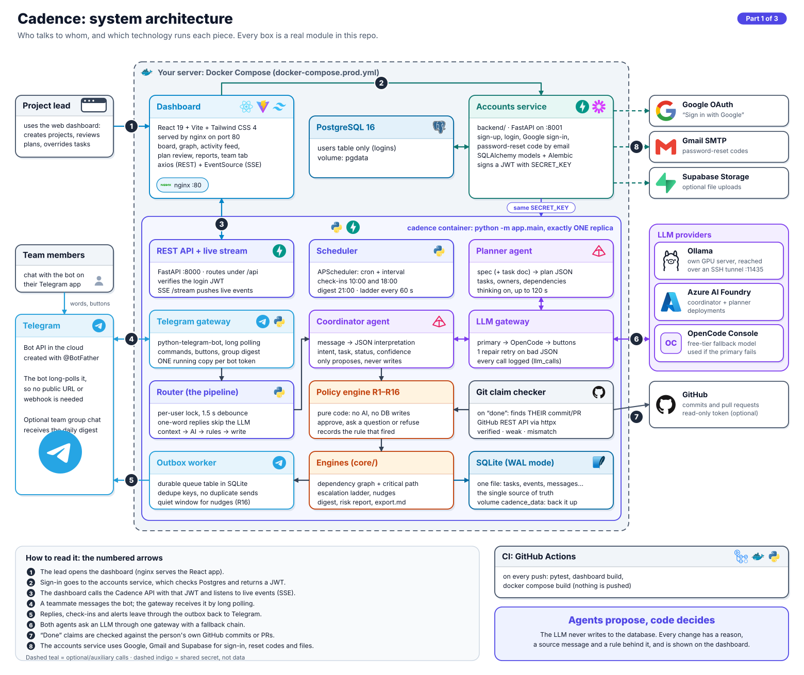
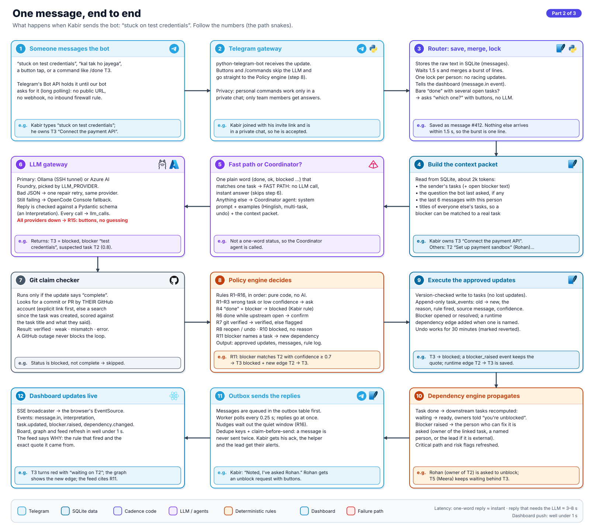
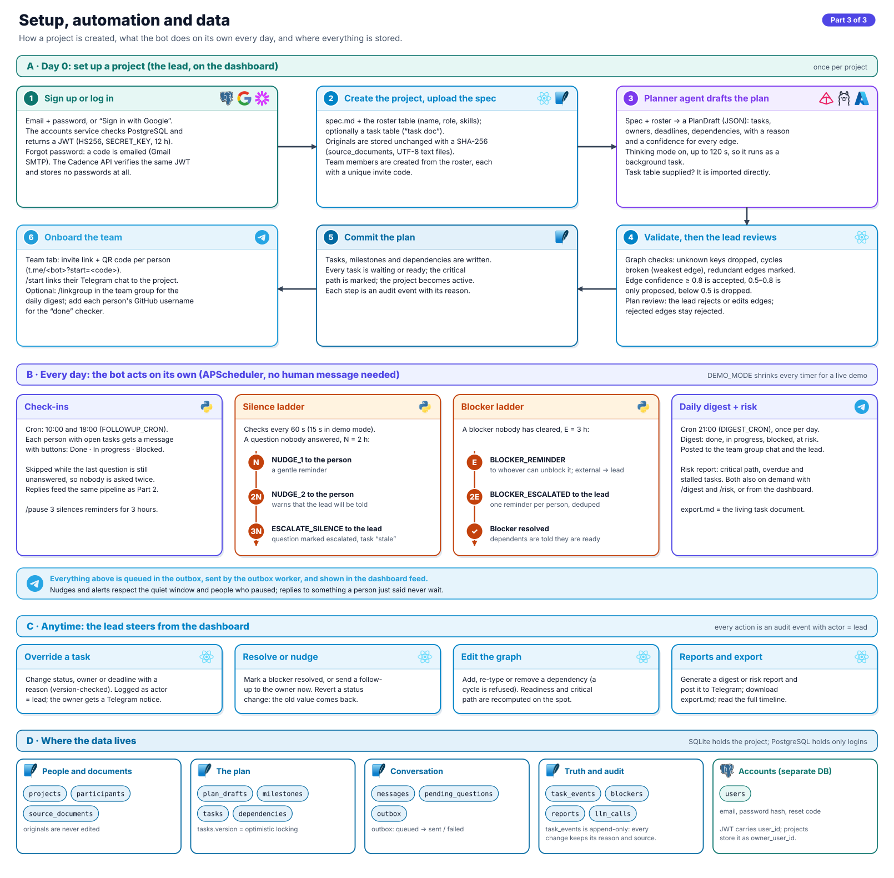
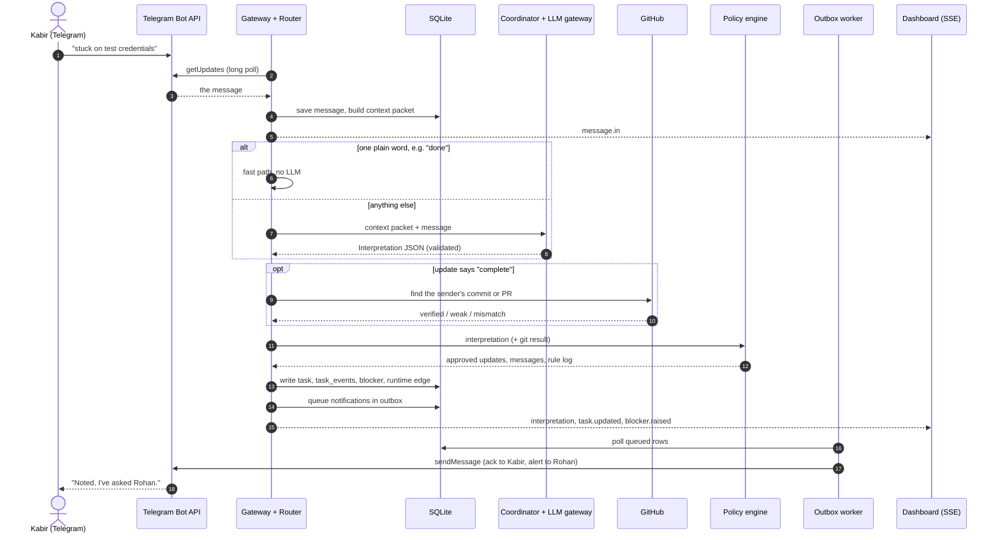

# Cadence: AI group project coordinator

Your team talks to a Telegram bot in plain words ("done", "stuck on credentials", "kal tak ho jayega").
Cadence turns that into task updates, chases blockers, warns about risk, and shows all of it live on a
website. The lead can also act from the website, and the team hears about it on Telegram.

Agents propose, code decides: the LLM never writes to the database. Every change has a reason, a
source message and a rule behind it, and is shown on the dashboard.

**Contents:** [Architecture](#architecture) · [How it works, end to end](#how-it-works-end-to-end) ·
[Setup and automation](#setup-and-automation) · [Tech stack](#tech-stack) · [Where the code lives](#where-the-code-lives) ·
[Deploy it](#deploy-it-the-bot-runs-in-one-place-not-on-laptops) · [Develop](#develop-on-your-own-machine)

## Architecture

Three diagrams, from the big picture down to the details. Click one to open it full size (the SVG stays
sharp when you zoom; PNG copies are in [`docs/architecture/png/`](docs/architecture/png/)).

### Part 1: the system and the tools it is built from

[](docs/architecture/1-system-architecture.svg)

Four deployable pieces, one shared secret:

| Piece | What it is | Talks to |
|---|---|---|
| **Dashboard** (`frontend/`) | React app served by nginx. The lead's view of the project. | Accounts service (login), Cadence API (data + live stream) |
| **Accounts service** (`backend/`) | FastAPI + PostgreSQL. Sign-up, login, Google sign-in, password-reset codes. Signs a JWT. | PostgreSQL, Google, Gmail, Supabase |
| **Cadence process** (`app/`) | One Python process: Telegram bot, scheduler, outbox worker, agents, rules, REST API + live stream. Keeps all project data in SQLite. | Telegram, an LLM, GitHub |
| **PostgreSQL** | Only the `users` table. | Accounts service |

The accounts service and the Cadence API share one `SECRET_KEY`: the first signs the JWT, the second
verifies it, so Cadence never stores a password.

### Part 2: one message, end to end

[](docs/architecture/2-message-flow.svg)

### Part 3: setup, daily automation and the data

[](docs/architecture/3-lifecycle-and-data.svg)

## How it works, end to end

Follow Kabir, who owns T3 "Connect the payment API" in the demo project, as he messages the bot
*"stuck on test credentials"*:

1. **Receive.** The bot long-polls Telegram, so the server needs no public URL. Buttons and `/commands`
   skip the model and go straight to step 6.
2. **Save and merge.** The router stores the raw text in SQLite, waits 1.5 s to merge a burst of lines,
   and takes a per-person lock so two messages never race.
3. **Context.** It builds a small packet from SQLite: Kabir's tasks, the last question the bot asked,
   the last 6 messages and everyone else's task titles.
4. **Interpret.** A plain one-word reply ("done") takes the **fast path** with no model call. Anything
   else goes to the **Coordinator agent** through the **LLM gateway**: Ollama or Azure AI Foundry first,
   one repair retry on bad JSON, then OpenCode Console. The answer must match a Pydantic schema. If every
   provider fails, the bot asks with buttons instead of guessing.
5. **Check claims.** If the update says "complete", the **Git claim checker** looks for a commit or PR
   by *that person's* GitHub account.
6. **Decide.** The **Policy engine** (rules R1 to R16, plain code, no model) approves, asks a question
   or refuses each update. Here R11 sees the blocker matches T2 "Set up payment gateway sandbox
   account" (Rohan) and adds a dependency T2 → T3.
7. **Write.** Approved updates are written with a version check, plus an append-only `task_events` row:
   old value, new value, the reason, the rule that fired, the source message and the confidence.
8. **Propagate.** The **dependency engine** recomputes which tasks are ready, asks Rohan to unblock T2 and
   refreshes the critical path.
9. **Reply.** Notifications go to the **outbox** table; a worker sends them to Telegram and never sends the
   same message twice. Kabir gets "I've asked Rohan"; Rohan gets an unblock request with buttons.
10. **Show.** The same change is pushed over Server-Sent Events, so the dashboard updates in well under a
    second and the activity feed says *why* (rule R11 and Kabir's exact words).

The same flow as a sequence of calls:



## Setup and automation

**Day 0 (the lead).** Sign up, create a project, upload a spec (and optionally a task table). The
**Planner agent** turns it into tasks, owners and dependencies, each edge with a reason and a
confidence. The graph is validated (cycles broken, duplicates dropped) and the lead reviews it before
anything is committed. Then each teammate opens their invite link from the **Team** tab.

**Every day (no human message needed).** A scheduler (APScheduler) sends check-ins at 10:00 and 18:00,
runs the **escalation ladders** every minute and posts the digest at 21:00:

| Situation | After | What happens |
|---|---|---|
| A question nobody answered | N = 2 h | `NUDGE_1` to the person |
| | 2N | `NUDGE_2`, warning the lead will be told |
| | 3N | `ESCALATE_SILENCE` to the lead; task flagged `stale` |
| A blocker nobody cleared | E = 3 h | Reminder to whoever can unblock it (an external blocker goes to the lead) |
| | 2E | `BLOCKER_ESCALATED` to the lead |

`DEMO_MODE=true` shrinks every timer for a live demo (keep it `false` for a real team).
**Anytime**, the lead can override a task, resolve a blocker, edit the dependency graph, send a
follow-up or generate reports from the dashboard; each action is logged with `actor = lead`.

## Tech stack

| | Technology | Used for |
|---|---|---|
|  | **Python 3.12** | The whole backend |
|  | **FastAPI** + uvicorn | Cadence API (`:8000`), accounts service (`:8001`), SSE stream |
|  | **Telegram Bot API** via python-telegram-bot | How the team talks to Cadence (long polling) |
|  | **SQLite** (WAL mode, aiosqlite) | All project data: tasks, events, messages, outbox |
|  | **PostgreSQL 16** + SQLAlchemy + Alembic | Logins only (`users`) |
|  | **JWT** (HS256) | The accounts service signs, the Cadence API verifies |
|  | **Pydantic** | Schemas the LLM output must match (Interpretation, PlanDraft) |
|  | **Ollama** (over an SSH tunnel) | Primary LLM on our own server |
|  | **Azure AI Foundry** | Alternative primary LLM (`LLM_PROVIDER=azure`) |
| OC | **OpenCode Console** | Fallback LLM when the primary fails |
|  | **GitHub REST API** | Checks "done" claims against the person's commits and PRs |
|  | **React 19**,  Vite,  Tailwind CSS 4 | The dashboard (axios for REST, `EventSource` for live updates) |
|  | **nginx** | Serves the built dashboard in production |
|   | **Google OAuth**, **Gmail SMTP** | Sign in with Google, password-reset codes |
|  | **Supabase Storage** | Optional file uploads from the accounts service |
|  | **Docker Compose** | One-command deployment (`docker-compose.prod.yml`) |
|  | **GitHub Actions** | Tests and image builds on every push |

## Where the code lives

```text
app/                      the Cadence process (python -m app.main)
  main.py                 starts API, Telegram polling, outbox worker and scheduler
  telegram/               gateway (commands, buttons), router (the pipeline), outbox, keyboards
  agents/                 coordinator, planner, fast path, prompts, Pydantic schemas
  llm/                    gateway (fallback chain, repair retry) + ollama, azure, opencode clients
  core/                   policy engine (R1-R16), dependency engine, escalation, reports, risk, handoff
  tools/git_checker.py    the Git claim checker
  scheduler/jobs.py       check-ins, escalation pass, digest
  api/                    REST routes, SSE stream, JWT check
  db/                     schema.sql, repo.py (all SQL), seed_demo.py
  templates/messages.yaml every message the bot can send
backend/                  accounts service (FastAPI + PostgreSQL + Alembic)
frontend/                 React dashboard (Vite, Tailwind)
scripts/                  setup_bot.py, check_llm.py, check_git_claim.py
tests/                    pytest suite (no network, token or LLM needed)
docs/                     STATUS.md, demo spec, and architecture/ (the diagrams)
```

The diagrams are generated from code so they stay easy to edit: change
`docs/architecture/build_diagrams.py`, run `python docs/architecture/build_diagrams.py` (standard library
only; the logos live in `docs/architecture/logos/` and are embedded into each SVG), and commit the result.

## Deploy it (the bot runs in ONE place, not on laptops)

On any Linux server or VM with Docker (a small cloud VM is enough):

```bash
git clone https://github.com/SahilJ1305/Cadence.git && cd Cadence
cp .env.example .env        # then fill in the values below
docker compose -f docker-compose.prod.yml up -d --build
```

Fill in `.env`:

| Setting | What to put |
|---|---|
| `TELEGRAM_BOT_TOKEN` | The token from @BotFather (see below). **Only on this server.** |
| `SECRET_KEY` | One long random value: `python -c "import secrets; print(secrets.token_urlsafe(48))"` |
| `POSTGRES_PASSWORD` | Any strong password for the login database |
| `LLM_PROVIDER` + keys | `azure` with `AZURE_AI_*`, or `ollama` with `OLLAMA_BASE_URL` and model names |
| `FRONTEND_URL`, `PUBLIC_AUTH_API_URL`, `PUBLIC_CADENCE_API_URL` | The public addresses of the dashboard and the two APIs |
| `DEMO_MODE` | `false` for a real team (see below) |
| `GITHUB_REPO`, `GITHUB_TOKEN` | Optional: lets Cadence check "done" claims against commits |

Then `python -m scripts.setup_bot` once (from any machine that has the token) to publish the bot's menu
and confirm nobody else is polling it. The dashboard is on port 80, the API on 8000, logins on 8001; put
a reverse proxy with HTTPS in front for real use. Back up the `cadence_data` volume (the project database).

GitHub Actions (`.github/workflows/ci.yml`) runs the tests and builds every image on each push, so
nothing needs to be run locally to know the code is healthy.

### Run it on your own machine (teammates)

Everyone can run the whole project independently from a fresh clone. Your copy has its own database,
its own logins and its own bot (or none).

**The easy way: one command (needs Docker).**

```bash
git clone https://github.com/SahilJ1305/Cadence.git && cd Cadence
docker compose up --build
```

That starts everything: the login database and service, the Cadence API (with the bot and scheduler)
and the dashboard, and it creates the FestPass demo project on the first start. Open
**http://localhost:5173**, sign up with any email, and you will see the demo project. No `.env` is needed
to start. Stop with `Ctrl+C` (or `docker compose down`). After pulling new code, run it with `--build` again.

| Address | What |
|---|---|
| http://localhost:5173 | The dashboard (reloads as you edit `frontend/`) |
| http://localhost:8000/api/health | The Cadence API and bot status |
| http://localhost:8001/docs | The login service |

To use AI or a bot, create your own `.env` first with `python -m scripts.init_env` (plain Python, no
install needed; it fills in fresh secrets) and add the values described in the table further down. `docker compose up` picks the `.env` up automatically. If your `.env` has
`TELEGRAM_BOT_TOKEN`, the bot runs inside the `cadence` container, so never also run `python -m app.main`.

**Without Docker.** You need **Python 3.11+** and **Node 20+**.

```bash
python -m venv .venv                                   # Windows: .venv\Scripts\activate
.venv/bin/pip install -r requirements.txt              # Windows: .venv\Scripts\pip install -r requirements.txt
.venv/bin/python -m scripts.init_env --no-docker       # your .env, with the login service on a local SQLite file
.venv/bin/pip install -r backend/requirements.txt      # the login service's packages
```

Then start three pieces, each in its own terminal:

| Piece | Command |
|---|---|
| Login service (:8001) | `cd backend && uvicorn main:app --port 8001` |
| Cadence API (:8000) | `python -m app.db.seed_demo` once (demo project), then `python -m app.main` |
| Dashboard (:5173) | `cd frontend && npm install && npm run dev` |

To check your setup without starting anything: `python -m pytest -q` (49 tests, no keys or bot needed).

What you can and cannot do without secrets:

| You have | You get |
|---|---|
| Nothing extra | The dashboard, API, demo project, every test |
| An AI key (ask the project owner through a password manager, or use your own) | The bot understands free-text replies and the planner turns a spec into tasks. Without it the bot falls back to button questions, and one-word replies like "done" still work |
| **Your own** Telegram bot (free, from @BotFather) | The live bot on your machine. Never use the team bot's token on a laptop |

The team's bot runs on the server only. Two copies sharing a token answer every message twice.
Your `.env` is git-ignored. Never commit it, and never copy someone else's.

### Create the Telegram bot (2 minutes, a person has to do this)

1. In Telegram open **@BotFather**, send `/newbot`, pick a name, and copy the token.
2. Run `python -m scripts.setup_bot <TOKEN>`. It checks the token, saves it to `.env`, publishes the
   command menu and description, removes any webhook, and tells you if another program already polls it.
3. Each teammate opens their invite link from the **Team** tab (`https://t.me/<bot>?start=<code>`).
4. Optional: add the bot to your team group, and the lead sends `/linkgroup` there for the daily digest.
   For the bot to see `@mentions` in that group, turn off its privacy mode: @BotFather → `/setprivacy` → your bot → **Disable**,
   then remove and re-add the bot to the group. (Without it, Telegram only shows the bot commands.)

**One token, one running copy.** If two copies poll the same token, Telegram answers both with
`409 Conflict`; messages are answered twice, or by a copy whose database has different data. This is
the usual cause of "everyone got duplicate messages" and "I see someone else's tasks". Never share the
token, never paste logs that contain it, and `/revoke` it in BotFather if it leaks.

## What the team can do on Telegram

| | |
|---|---|
| Plain messages | "done", "stuck on test credentials", "slides done, video left", Hinglish |
| Buttons | answer any question the bot asks; they never go through the LLM |
| `/mytasks` `/next` `/status` | see your tasks, your next ready task, the overview |
| `/done T3` `/blocked T3 why` `/undo` | explicit updates, still checked by the Policy Engine |
| `/recheck` | check your finished tasks against your GitHub commits again (also a button) |
| `/pause 3` | no reminders for 3 hours (`/pause 0` resumes) |
| `/digest` `/risk` | post a report (the lead anywhere, anyone in the linked team group) |
| `/linkgroup` | the lead sends this in the team group |
| Messages to people | "tell the lead the API key is missing", "@Rohan can you share the keys?", "Rohan ko bolo ki PR merge kar de"; the bot passes them on, and the person can answer with "tell Priya ...". A call-out in the linked team group is also sent to that person privately |
| Lead clears a blocker | "unblock Kabir, use the shared key" (or the **Resolve** button on the website): the owner is told and the task moves to In progress |

## What the website shows (updates in well under a second)

Board with owner, "waiting on" badges, blockers, flags and the last quote · task drawer with the full
timeline, conversation and lead override · dependency graph with the critical path · live activity feed
that explains *why* each change happened (the policy rule that fired) · plan review · digest and risk
reports (post to Telegram from the page) · `export.md` living task doc · team panel with invite links,
QR codes and GitHub usernames.

## "Done" is checked against GitHub

When someone says a task is done, Cadence looks for a commit or pull request **by their GitHub
account** that matches the task. Set `GITHUB_REPO` (and a read-only `GITHUB_TOKEN`) in `.env` and give
each teammate a GitHub username on the Team tab. A match marks the task *verified* and keeps the commit
as evidence. Someone else's commit, or no commit, leaves it *complete (unverified)*, asks for a link,
and tells the lead. **Cadence never guesses a GitHub username.** If someone has none on the Team tab, the bot says so when they
join and again when they say "done". The task is still taken as complete, but marked *unverified*, the lead is
told once, and nothing is sent to GitHub. When the lead saves the username, that person gets a message with a
**Recheck my tasks** button (or they can send `/recheck`), which runs the checker over everything they already
finished. Only a logged-in user can set a username.

Try it: `python -m scripts.check_git_claim <user> T3 "task title" "what they said"`.

## How it maps to the spec

Tier 1 (the required loop), Tier 2 (clarify, undo, multi-task, manual override, LLM fallback) and Tier 3
(dependencies and propagation, blocker routing, escalation ladder, digest, risk and critical path,
living task doc, handoffs, "done" verification) are all implemented. Spec: `Cadence_ AI Group Project
Coordinator — Spec v0.1.md`. Not built: stretch goals S1-S5 (group chat reading, meeting slots, Slack,
voice notes, re-plan diff).

## Tests

```bash
.venv/bin/python -m pytest -q
```

`tests/test_e2e_telegram_website.py` runs the real bot, policy engine, outbox and HTTP API against a
pretend Telegram (`tests/fake_telegram.py`) and a scripted Coordinator, and checks all four sides of each
scenario: what the bot said, the database, the website API and the live event stream. No network, no
token and no LLM are needed.
